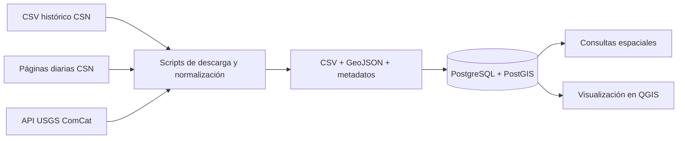

# Sistema espacial de sismicidad en Chile

Proyecto académico para descargar, normalizar, almacenar y analizar eventos sísmicos de Chile con **Python**, **PostgreSQL/PostGIS** y **QGIS**.

El sistema integra el catálogo histórico y las publicaciones diarias del Centro Sismológico Nacional (CSN), complementadas con eventos de USGS ComCat. Su objetivo es estudiar cómo se distribuyen los sismos en el espacio, el tiempo, la magnitud y la profundidad. **No es un sistema de predicción de terremotos.**

## Qué permite hacer

- Descargar y normalizar datos públicos del CSN y USGS.
- Conservar la fuente, el identificador y la magnitud original de cada evento.
- Cargar los catálogos en PostGIS sin duplicar eventos.
- Consultar sismos por fecha, magnitud, profundidad, distancia o región.
- Visualizar los epicentros en QGIS mediante geometrías `Point` en `EPSG:4326`.
- Registrar cada ejecución de carga para mantener trazabilidad.



## Estado actual

La última carga validada durante el desarrollo contiene:

| Fuente | Eventos | Cobertura del catálogo cargado |
| --- | ---: | --- |
| CSN | 57.488 | 1513-01-01 a 2026-09-22 14:40:50 UTC |
| USGS | 42 | Ventana 2026-08-01 a 2026-08-30; el último evento observado fue del 2026-08-29 |
| **Total** | **57.530** | Identificadores únicos por fuente y geometrías válidas |

Esta carga fue verificada el 2026-09-22. No es un contador en tiempo real: al volver a ejecutar los descargadores, los resultados pueden cambiar por nuevos eventos o revisiones de las fuentes. Un mismo sismo también puede aparecer una vez por fuente si fue publicado tanto por CSN como por USGS.

Desde el 2026-11-06 la base también contiene la **División Político Administrativa 2023** (SUBDERE / IDE Chile): 16 regiones, 56 provincias y 345 comunas. Cada sismo quedó asignado a una comuna:

- 23.156 sismos tienen el epicentro dentro de una comuna (`covers`);
- 34.375 están en el mar o fuera de Chile y se asignaron a la comuna más cercana (`nearest`), con su distancia en `distance_km`.

Las fuentes publican magnitudes en escalas distintas (Mw convertida, magnitud local tipo Richter, `mb`...). Para comparar, 45.617 eventos (79 %) tienen además un **Mw homogéneo** (`mw_homogenized`), calculado con las fórmulas de conversión del propio CSN. Ver [`docs/MAGNITUDES.md`](docs/MAGNITUDES.md).

Desde el 2026-11-07 la base contiene también las **zonas urbanas y la población del Censo 2024** (INE): 592 ciudades y pueblos y 216.341 manzanas. La comuna cubre todo su territorio (la de Calama mide 15.545 km² y su ciudad 37 km²), así que estas tablas dicen dónde vive la gente:

- cada sismo tiene su zona urbana más cercana, con distancia al epicentro y al hipocentro;
- cada sismo Mw ≥ 5 tiene todas las zonas urbanas a 200 km o menos y la población censada a 25, 50 y 100 km.

Ver [`docs/INE_CENSO2024.md`](docs/INE_CENSO2024.md).

La base cuenta con:

- catorce tablas y una vista (`v_event_location`) en el esquema `seismic`;
- jerarquía comuna → provincia → región en `administrative_area`;
- catálogo de tipos de magnitud y fórmulas de conversión a Mw (`magnitude_type`, `magnitude_conversion`, `magnitude_conversion_rule`);
- zonas urbanas, manzanas y su relación con los sismos (`urban_area`, `census_block`, `event_urban_area`, `event_population_exposure`);
- índices temporales, de magnitud y espaciales GiST, más trozos de comuna (`ST_Subdivide`) para consultas rápidas;
- carga transaccional e idempotente con `UPSERT`;
- historial de cargas en `seismic.ingestion_run`;
- 14 consultas básicas por región, comuna, distancia, profundidad, densidad, zona urbana y población en [`db/queries.sql`](db/queries.sql).

El modelo lógico v2, la carga de la DPA y el diseño de las próximas etapas (réplicas, intensidad USGS) están documentados en [`docs/MODELO_LOGICO_v2.md`](docs/MODELO_LOGICO_v2.md).

## Fuentes de datos

| Fuente | Uso en el proyecto | Actualidad esperada |
| --- | --- | --- |
| [Centro Sismológico Nacional](https://www.sismologia.cl/) | CSV histórico más páginas diarias oficiales | El CSV llega al 2025-06-23 y las páginas diarias completan desde el 2025-06-24 hasta el día de ejecución |
| [USGS ComCat](https://earthquake.usgs.gov/fdsnws/event/1/) | Eventos recientes dentro del rectángulo de Chile | Consulta bajo demanda; los eventos recientes pueden ser preliminares |
| DPA 2023 (SUBDERE / IDE Chile) | Polígonos de regiones, provincias y comunas | Versión estática publicada el 2023-08-03; shapefile en SIRGAS-Chile (EPSG:5360) |
| [Censo 2024, INE](https://censo2024.ine.gob.cl/resultados/) | Zonas urbanas y manzanas con población | Versión estática publicada el 2025-12-16; GeoParquet en SIRGAS 2000 (EPSG:4674) |

El uso académico de los datos del CSN debe citar al **Centro Sismológico Nacional de la Universidad de Chile** y respetar sus [condiciones de uso](https://sismologia.cl/accesos/uso-de-datos.html).

Todo mapa que muestre los límites de la DPA debe llevar la leyenda: *"Autorizada su circulación por Resolución Nº 87 del 2023 de la Dirección Nacional de Fronteras y Límites del Estado"*.

Los datos del censo deben citarse como *Instituto Nacional de Estadísticas (INE), Censo de Población y Vivienda 2024, Base Cartográfica Censal*.

## Estructura del repositorio

```text
.
├── db/
│   ├── schema.sql                 # Modelo relacional y espacial (v2)
│   ├── apply_schema.sql           # Creación y validación de la base
│   ├── load_catalogs.sql          # Carga idempotente de CSN y USGS
│   ├── load_dpa.sql               # Carga de regiones, provincias y comunas
│   ├── assign_event_areas.sql     # Asignación de cada sismo a una comuna
│   ├── homogenize_magnitudes.sql  # Mw homogéneo de cada sismo
│   ├── validate_ml_conversion.sql # Validación de la fórmula Ml -> Mw
│   ├── load_census.sql            # Carga de zonas urbanas y manzanas (Censo 2024)
│   ├── assign_urban_exposure.sql  # Zonas urbanas y población cerca de cada sismo
│   └── queries.sql                # Consultas básicas
├── docs/
│   ├── MODELO_LOGICO_v2.md        # Modelo lógico, carga y próximas etapas
│   ├── MAGNITUDES.md              # Escalas de magnitud y conversión a Mw
│   └── INE_CENSO2024.md           # Zonas urbanas y población (Censo 2024)
├── scripts/
│   ├── download_csn_catalog.py
│   ├── download_usgs_earthquakes.py
│   ├── run_csn_catalog_qgis.cmd
│   ├── run_usgs_earthquakes_qgis.cmd
│   ├── start_local_postgis.ps1
│   ├── stop_local_postgis.ps1
│   ├── load_catalogs_postgis.ps1
│   ├── load_dpa_postgis.ps1
│   ├── load_ine_manzanas_postgis.ps1  # Carga del Censo 2024 (usa el GDAL de QGIS)
│   └── validate_ml_conversion.py  # Descarga de datos para validar Ml -> Mw
├── data/earthquakes/README.md     # Diccionario y detalles de los productos
├── .env.example                   # Configuración local sin contraseña real
├── compose.yaml                   # Alternativa con Docker
└── README.md
```

Los archivos descargados y procesados se guardan bajo `data/raw/` y `data/processed/`. Están excluidos de Git por su tamaño y por pertenecer a sus respectivas fuentes; se recrean con los scripts del repositorio.

## Requisitos

La configuración actualmente probada usa Windows con:

- Git;
- PowerShell;
- PostgreSQL 18 con PostGIS instalado;
- QGIS 3.44.13 LTR, cuyo Python se usa para las descargas HTTPS.

Los scripts de PowerShell buscan PostgreSQL en `C:\Program Files\PostgreSQL\18\bin` y los lanzadores `.cmd` buscan QGIS en `C:\Program Files\QGIS 3.44.13\bin`. Si se instalaron en otra ruta, hay que ajustar esas variables en los scripts.

Los descargadores usan solamente la biblioteca estándar de Python, por lo que también pueden ejecutarse con otro Python 3 que tenga certificados HTTPS configurados.

## Puesta en marcha

### 1. Clonar y configurar

```powershell
git clone https://github.com/G6B0/Proyecto_Base_de_datos_espaciales.git
cd Proyecto_Base_de_datos_espaciales
Copy-Item .env.example .env
```

Editar `.env` y reemplazar `cambia_esta_clave_local` por una contraseña local. El archivo `.env` está ignorado por Git y no debe compartirse.

### 2. Iniciar PostGIS

```powershell
PowerShell -ExecutionPolicy Bypass -File .\scripts\start_local_postgis.ps1
```

Este script crea un clúster aislado en `%LOCALAPPDATA%\SismosChilePostgres`, escucha solo en `127.0.0.1:5433` y no modifica otra instancia que esté usando el puerto estándar `5432`.

Como alternativa, si Docker Desktop está disponible:

```powershell
docker compose up -d
```

### 3. Descargar los catálogos

Catálogo histórico y eventos diarios del CSN:

```powershell
.\scripts\run_csn_catalog_qgis.cmd
```

La primera ejecución descarga una página oficial por día desde el
2025-06-24. Después reutiliza la caché local y vuelve a consultar solamente los
últimos siete días para recoger revisiones. El rango también puede controlarse:

```powershell
.\scripts\run_csn_catalog_qgis.cmd --recent-start 2025-06-24 --recent-end 2026-09-22 --refresh-days 7
```

Eventos USGS de los últimos 30 días:

```powershell
.\scripts\run_usgs_earthquakes_qgis.cmd
```

Para reproducir la muestra validada:

```powershell
.\scripts\run_usgs_earthquakes_qgis.cmd --start 2026-08-01 --end 2026-08-30 --min-magnitude 2.5
```

El rectángulo predeterminado es longitud `-76` a `-66` y latitud `-56` a `-17`. Incluye Chile continental, zonas oceánicas y algunos sectores limítrofes; la clasificación definitiva debe hacerse con límites administrativos en PostGIS.

### 4. Cargar los datos

```powershell
PowerShell -ExecutionPolicy Bypass -File .\scripts\load_catalogs_postgis.ps1
```

El cargador usa el CSV del CSN y el CSV de USGS más reciente. Volver a ejecutarlo actualiza los eventos existentes sin duplicarlos.

También se pueden indicar archivos concretos:

```powershell
PowerShell -ExecutionPolicy Bypass -File .\scripts\load_catalogs_postgis.ps1 `
  -CsnCsv .\data\processed\csn\csn_earthquake_catalog.csv `
  -UsgsCsv .\data\processed\usgs\usgs_earthquakes_chile_m2.5_20260801_20260830.csv
```

Al terminar, este script calcula el Mw homogéneo de cada evento; si la DPA ya está cargada, recalcula su comuna, y si el censo ya está cargado, calcula la zona urbana y la población cercanas de los eventos nuevos (modo incremental, segundos).

### 5. Cargar la DPA y asignar comunas

Requiere el zip oficial en `data\raw\chile_boundaries\dpa_2023.zip` (311 MB, no se versiona en Git).

```powershell
PowerShell -ExecutionPolicy Bypass -File .\scripts\load_dpa_postgis.ps1
```

El script extrae solo los shapefiles necesarios, los importa con `shp2pgsql`, los reproyecta de SIRGAS-Chile (EPSG:5360) a WGS 84 (EPSG:4326), valida geometrías y jerarquía, y asigna cada sismo a una comuna. Tarda unos dos minutos y puede repetirse sin duplicar datos.

### 6. Cargar el Censo 2024 (zonas urbanas y población)

Requiere la DPA cargada, QGIS 3.44 instalado (se usa su GDAL para leer GeoParquet) y el zip oficial del INE en `data\raw\ine\Cartografia_censo2024_Pais.zip` (758 MB, no se versiona en Git):

```powershell
curl.exe -L -o data\raw\ine\Cartografia_censo2024_Pais.zip "https://storage.googleapis.com/bktdescargascenso2024/Cartografia/GEOPARQUET/Cartografia_censo2024_Pais.zip"
PowerShell -ExecutionPolicy Bypass -File .\scripts\load_ine_manzanas_postgis.ps1
```

Carga las zonas urbanas y las manzanas en ~30 s y luego calcula la cercanía de todos los sismos a las zonas urbanas y la población cercana en 10–12 minutos. Puede repetirse sin duplicar datos. Detalle en [`docs/INE_CENSO2024.md`](docs/INE_CENSO2024.md).

### 7. Consultar o visualizar

Las consultas preparadas están en [`db/queries.sql`](db/queries.sql). Por ejemplo:

```sql
SELECT
    occurred_at,
    magnitude,
    magnitude_type,
    depth_km,
    ST_Y(geom) AS latitude,
    ST_X(geom) AS longitude
FROM seismic.earthquake_event
WHERE occurred_at >= now() - interval '30 days'
ORDER BY occurred_at DESC;
```

Para conectar QGIS:

| Campo | Valor |
| --- | --- |
| Servidor | `127.0.0.1` |
| Puerto | `5433` |
| Base de datos | `sismos_chile` |
| Usuario | `sismos_app` |
| Contraseña | valor de `POSTGRES_PASSWORD` en `.env` |
| Capa principal | `seismic.v_event_location` (sismos con comuna, provincia y región) |
| Límites | `seismic.administrative_area` filtrada por `level` (`region`, `province`, `commune`) |
| Zonas urbanas | `seismic.urban_area` (ciudades y pueblos con población) |
| Geometría | `geom` (`Point` o `MultiPolygon`, `EPSG:4326`) |

Para detener la instancia local:

```powershell
PowerShell -ExecutionPolicy Bypass -File .\scripts\stop_local_postgis.ps1
```

## Calidad y limitaciones

- Las horas se normalizan a UTC y los epicentros se almacenan en WGS 84 (`EPSG:4326`).
- La geometría es 2D; la profundidad hipocentral se conserva en `depth_km`.
- `magnitude` es el valor publicado por la fuente y mezcla escalas: debe leerse junto con `magnitude_type`. Para filtrar o comparar se usa `mw_homogenized`. La conversión de `Ml` está validada y la de `Mlv` (desde 2026) es provisional. Para comparar el catálogo histórico con las páginas diarias conviene un umbral de Mw 4,5 ([`docs/MAGNITUDES.md`](docs/MAGNITUDES.md)).
- La carga validada conserva 293 eventos sin profundidad y 15 profundidades negativas publicadas por la fuente, para permitir control de calidad sin alterar evidencia.
- La población proviene del Censo 2024 y cubre manzanas urbanas y de aldea (87,6 % de la población censada). Describe a quienes hoy viven cerca de un epicentro; no es una estimación de daño.
- El catálogo global de USGS puede omitir sismos pequeños detectados por redes locales.
- Los eventos recientes pueden cambiar de magnitud, profundidad, ubicación o estado de revisión.
- Las páginas diarias recientes del CSN se vuelven a descargar durante siete días para incorporar posibles revisiones.
- Ninguna consulta del proyecto debe interpretarse como predicción de actividad sísmica futura.

## Licencia

El código de este repositorio se distribuye bajo la [licencia MIT](LICENSE). Los datos descargados no quedan cubiertos por esa licencia: mantienen las condiciones, atribuciones y restricciones de sus fuentes originales.
