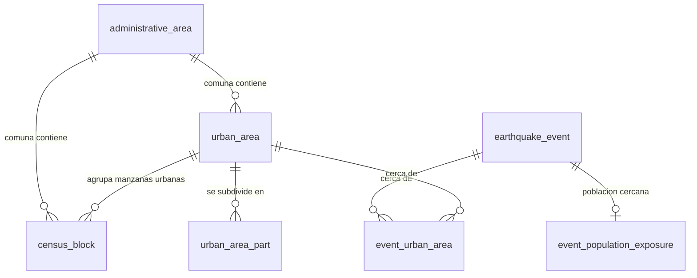

# Zonas urbanas y población: Censo 2024 (INE) en PostGIS

**Origen:** guía y script preparados por Ignacio Barría. Integrados al repositorio el 2026-11-06, con las correcciones de la sección 9.
**Para qué sirve:** saber **dónde vive la gente** dentro de cada comuna, y cruzarlo con los sismos: qué ciudades quedan cerca de cada sismo y cuánta población vive a 25, 50 y 100 km del epicentro.

---

## 1. Por qué hace falta (la comuna no es la ciudad)

La asignación de comunas (`event_administrative_area`) usa el polígono completo de la comuna, que incluye la ciudad, el campo, la cordillera y el desierto. Por ejemplo:

| Comuna | Superficie de la comuna | Superficie urbana (Censo 2024) | Población urbana |
|---|---:|---:|---:|
| Calama | 15.545 km² | 36,8 km² (0,2 %) | 156.882 |
| Antofagasta | 30.702 km² | 61,2 km² (0,2 %) | 388.478 |
| Santiago | 23 km² | 23,1 km² (100 %) | 432.081 |

"216 sismos Mw≥5 en la comuna de Calama" no significa "216 sismos bajo la ciudad de Calama": de esos 216 epicentros, **solo 1** cae dentro de la ciudad (consulta 14). La cartografía del Censo 2024 trae los polígonos de cada ciudad y pueblo y su población, y con eso se puede preguntar lo que importa.

---

## 2. Qué datos se usan

El INE publicó el 16-12-2025 la **Base Cartográfica Censal** del Censo 2024, con 10 capas en tres formatos (File Geodatabase, GeoPackage y GeoParquet). Cada polígono trae directamente las 189 variables del censo (personas, hogares, viviendas), sin necesidad de unir tablas.

Se usan **dos capas** del archivo nacional en GeoParquet:

| Capa INE | Qué es | Registros | Población | Tabla en el modelo |
|---|---|---:|---:|---|
| `Limite_Urbano_CPV24` | Polígono de cada **ciudad** (más de 5.000 habitantes) y **pueblo** (1.000 a 5.000). | 592 (271 ciudades, 321 pueblos) | 15.777.741 | `seismic.urban_area` |
| `Manzanas_CPV24` | **Manzanas** urbanas y de **aldea** (caseríos agrupados de 301 a 2.000 habitantes). | 216.341 (207.154 urbanas, 9.187 de aldea) | 16.185.953 | `seismic.census_block` |

Datos que vale la pena conocer:

- **Las manzanas urbanas suman exactamente la población de las zonas urbanas** (15.777.741). La carga lo verifica.
- **Las manzanas no cubren todo el país.** El censo contó 18.480.432 personas; las manzanas suman 16.185.953 (87,6 %). La diferencia (~2,3 millones) es principalmente población rural dispersa, que el INE publica en otras capas (`Entidades`, `Localidades`) con polígonos Thiessen; también quedan fuera las personas que el INE asignó solo a nivel de comuna (operativos especiales y situación de calle; manual del INE, sección 4.1). Por eso hablamos de **"población en manzanas"** o **"población urbana"**, no de "toda la población".
- **Conurbaciones.** El INE separa las grandes ciudades por comuna: el Gran Santiago son 40 zonas urbanas (una por comuna) que suman 6.255.650 personas. La columna `conurbation` permite agruparlas (Gran Santiago, Gran Valparaíso, Gran Concepción, La Serena - Coquimbo, etc.; 26 en total).
- **Secreto estadístico.** En manzanas con muy pocas viviendas, el INE agrupó polígonos ("indeterminación geográfica") o dejó variables en NULL. `n_per` (personas) nunca es NULL; otras variables a veces sí. 48.046 manzanas tienen `MZ_BASE_CENSO = 0`, es decir, no tienen datos en los tabulados censales.
- **Sistema de coordenadas.** SIRGAS 2000 (EPSG:4674). Para estos datos se considera equivalente a WGS 84 (diferencia menor a un metro); se reproyecta a 4326 para cruzar con los sismos.

### Variables que se guardan

De las 189 variables, el modelo guarda las que sirven para describir **exposición y vulnerabilidad** ante un sismo:

| Columna en el modelo | Variable INE | Significado (diccionario oficial) |
|---|---|---|
| `population` | `n_per` | Personas censadas (viviendas particulares, colectivas y situación de calle). |
| `population_0_5` | `n_edad_0_5` | Niños de 0 a 5 años. Solo en `urban_area`. |
| `population_60_plus` | `n_edad_60_mas` | Personas de 60 años o más. |
| `population_disability` | `n_discapacidad` | Personas de 5 años o más con mucha dificultad o imposibilidad en alguna actividad. Solo en `urban_area`. |
| `households` | `n_hog` | Hogares. Solo en `urban_area`. |
| `private_dwellings` | `n_vp` | Viviendas particulares. |
| `dwellings_adobe` | `n_mat_paredes_artesanal` | Viviendas con paredes de **adobe, barro, pirca, quincha** u otro material artesanal. Se usa como indicador de vulnerabilidad sísmica de la vivienda. |
| `dwellings_precarious` | `n_mat_paredes_precarios` | Viviendas con paredes de materiales precarios o de desecho. Solo en `urban_area`. |

Las demás variables siguen en el parquet original por si se necesitan después.

---

## 3. Cómo quedó en el modelo



| Tabla | Qué guarda | Llave | Filas |
|---|---|---|---:|
| `urban_area` | Ciudades y pueblos con población, viviendas e indicadores. FK a su comuna. | `urban_area_id`; UNIQUE `ine_entity_id` (ID_ENTIDAD del INE) | 592 |
| `urban_area_part` | Trozos de cada zona urbana (`ST_Subdivide`, ≤ 255 vértices). Técnica, como `administrative_area_part`. | `urban_area_part_id` | 7.259 |
| `census_block` | Manzanas con población y su **punto interior** (`ST_PointOnSurface`). FK a comuna y, si es urbana, a su zona urbana. | `census_block_id`; UNIQUE `block_code` (MANZENT) | 216.341 |
| `event_urban_area` | Relación N:M sismo ↔ zona urbana con distancia epicentral e hipocentral y orden (`distance_rank`). | (`earthquake_event_id`, `urban_area_id`) | 376.948 |
| `event_population_exposure` | Población, mayores de 60 y viviendas de adobe a 25, 50 y 100 km de cada sismo Mw ≥ 5. | `earthquake_event_id` | 6.388 |

### Reglas de `event_urban_area`

1. **Todo sismo** guarda su zona urbana más cercana (`distance_rank = 1`).
2. **Los sismos con Mw homogéneo ≥ 5** guardan además **todas** las zonas urbanas a 200 km o menos del epicentro, numeradas por distancia.

- **Distancia epicentral:** geodésica, desde el epicentro hasta el **borde** de la zona urbana. Es 0 si el epicentro cae dentro de la ciudad.
- **Distancia hipocentral:** `√(epicentral² + profundidad²)`. Un sismo justo debajo de Calama a 110 km de profundidad está a 0 km epicentral pero a 110 km hipocentral. Es la distancia que más se relaciona con cuánto se siente el sismo.

### Cómo se mide la distancia a una zona urbana (y por qué en dos etapas)

Medir la distancia de un punto a un polígono sobre `geography` (el elipsoide, en metros) es exacto pero caro. Midiendo así todos los trozos de zona urbana cercanos, el cálculo completo tardaba **26 minutos**. Ahora se hace en dos etapas:

1. **Aproximada:** `ST_ClosestPoint` busca, en el plano, el punto del trozo más cercano al epicentro, y solo se mide sobre el elipsoide la distancia entre esos dos puntos. Ese punto está sobre el trozo, así que la aproximada **nunca es menor** que la exacta; en las pruebas se alejó en promedio 4 m y como máximo 0,4 km.
2. **Exacta:** `ST_Distance` sobre `geography`, solo contra los trozos cuya aproximada está a menos de 2 km de la mejor. Como la aproximada nunca subestima y su error es mucho menor que 2 km, el trozo realmente más cercano siempre queda entre los medidos.

**Verificación (2026-11-07):** se comparó con el cálculo exacto completo. Los 376.948 vínculos, sus distancias al metro, su orden y la población de los 6.388 sismos coinciden **sin ninguna diferencia**. Una primera versión, que medía exacto solo el trozo ganador, dejaba 3.830 distancias hasta 0,3 km más largas y cambiaba la zona más cercana de 9 sismos; por eso se agregó el margen.

### Regla de `event_population_exposure`

Para cada sismo con Mw ≥ 5, suma la población de las manzanas cuyo **punto interior** está a 25, 50 y 100 km del epicentro (distancia geodésica). También guarda mayores de 60 años y viviendas de adobe a 50 km, y cuántas zonas urbanas hay a 50 km.

**Qué no es:** no es una estimación de daño ni de intensidad. Dice cuánta gente vive cerca del epicentro. Para intensidad hacen falta los contornos ShakeMap (etapa del 1–7 dic).

---

## 4. Cómo cargarlo

### Paso 1: descargar los datos del INE

El archivo oficial está en el almacenamiento público de descargas del Censo 2024 del INE (`storage.googleapis.com/bktdescargascenso2024`, el mismo desde el que el INE publica otras descargas del censo):

| Archivo | URL | Tamaño |
|---|---|---:|
| Cartografía país, GeoParquet | `https://storage.googleapis.com/bktdescargascenso2024/Cartografia/GEOPARQUET/Cartografia_censo2024_Pais.zip` | 758 MB |
| Manual de uso de la cartografía censal | `https://storage.googleapis.com/bktdescargascenso2024/Datos_agregados/Manual_uso_cartografia_CPV2024.pdf` | 1 MB |
| Diccionario de variables | `https://storage.googleapis.com/bktdescargascenso2024/Datos_agregados/diccionario_variables_glosas_censo2024.xlsx` | 3 MB |

Se guardan en `data\raw\ine\`. Esa carpeta está excluida de Git (`data/raw/`).

```powershell
curl.exe -L -o data\raw\ine\Cartografia_censo2024_Pais.zip "https://storage.googleapis.com/bktdescargascenso2024/Cartografia/GEOPARQUET/Cartografia_censo2024_Pais.zip"
```

El zip trae 11 archivos (todas las capas en parquet y un diccionario). El script extrae solo los dos que usa.

### Paso 2: requisitos

- La base iniciada (`scripts\start_local_postgis.ps1`, que además aplica `db\schema.sql`).
- **La DPA cargada** (`scripts\load_dpa_postgis.ps1`): cada zona urbana y manzana se une a su comuna.
- **QGIS 3.44** instalado. El script usa el GDAL de QGIS para leer GeoParquet (probado con 3.44.13 y 3.44.15).
- Unos 2 GB libres (zip + extracción + base).

### Paso 3: ejecutar

```powershell
PowerShell -ExecutionPolicy Bypass -File .\scripts\load_ine_manzanas_postgis.ps1
```

Prueba rápida que no toca el modelo (1.000 registros por capa, solo en `ine_staging`):

```powershell
PowerShell -ExecutionPolicy Bypass -File .\scripts\load_ine_manzanas_postgis.ps1 -Limit 1000
```

| Parámetro | Para qué sirve |
|---|---|
| `-Limit 1000` | Prueba: carga N registros por capa en `ine_staging` y se detiene. No modifica el modelo. |
| `-StagingOnly` | Deja las capas completas en `ine_staging` sin pasarlas al modelo (para explorar). |
| `-SkipAssignment` | Carga zonas urbanas y manzanas, pero no recalcula la cercanía a sismos. |
| `-CheckGeometry` | Cuenta geometrías inválidas en `ine_staging` (tarda). |
| `-ZipPath "ruta"` | Zip del INE en otra ubicación. |
| `-ParquetDir "ruta"` | Carpeta con los `.parquet` ya extraídos (se salta el zip). |
| `-QgisRoot "ruta"` | Carpeta de QGIS, si la detección automática falla. |
| `-PgBin "ruta"` | Carpeta `bin` de PostgreSQL (por defecto `C:\Program Files\PostgreSQL\18\bin`). |

La conexión se lee de `.env` (`POSTGRES_DB`, `POSTGRES_USER`, `POSTGRES_PASSWORD`, `POSTGRES_PORT`). Volver a ejecutarlo reemplaza los datos sin duplicar.

### Qué hace por dentro

| Paso | Archivo | Qué hace |
|---|---|---|
| 1 | `scripts/load_ine_manzanas_postgis.ps1` | Extrae del zip solo `Limite_Urbano` y `Manzanas`. Si ya están extraídos con el mismo tamaño, no repite. |
| 2 | ídem | Detecta QGIS, carga su entorno y comprueba que GDAL lea Parquet. |
| 3 | ídem | `ogr2ogr` importa cada capa a `ine_staging` reproyectando a 4326 y **solo con las columnas que usa el modelo** (`-select`). Tarda ~20 s. |
| 4 | `db/load_census.sql` | En una transacción: controla códigos únicos y que cada comuna del INE exista en la DPA; registra la carga en `ingestion_run` (fuente `ine`); hace UPSERT de zonas urbanas por `ID_ENTIDAD`; regenera los trozos; reemplaza las manzanas; verifica que la población urbana cuadre con la de las manzanas y que no haya geometrías inválidas; borra `ine_staging`. |
| 5 | `db/assign_urban_exposure.sql` | En una transacción: recalcula **completos** `event_urban_area` y `event_population_exposure`. Tarda entre 10 y 12 minutos. |

`db/assign_urban_exposure.sql` tiene dos modos:

| Modo | Cómo se llama | Qué calcula | Tiempo | Quién lo usa |
|---|---|---|---|---|
| Completo | `psql ... -f db/assign_urban_exposure.sql` | Todo, desde cero. | 10–12 min | El cargador del censo. |
| Incremental | `psql ... -v incremental=1 -f db/assign_urban_exposure.sql` | Solo los sismos sin resultado (nuevos) y los que llegaron a Mw ≥ 5 sin población calculada. Además, borra la población y las zonas a 200 km de los que bajaron de Mw 5. | Segundos (300 sismos en 17 s; sin pendientes, 0,4 s) | `scripts/load_catalogs_postgis.ps1`, después de cada carga de sismos. |

El modo incremental **no detecta** un sismo ya calculado al que la fuente le corrigió la ubicación. En la práctica casi no ocurre (el catálogo histórico del CSN no cambia), pero antes de una entrega conviene ejecutar el modo completo.

---

## 5. Resultados de la carga (2026-11-06)

| Verificación | Resultado |
|---|---|
| Zonas urbanas | 592: 271 ciudades (15.103.647 personas) y 321 pueblos (674.094). Superficie urbana total: 3.435 km² (0,5 % de Chile). |
| Manzanas | 216.341: 207.154 urbanas (15.777.741 personas) y 9.187 de aldea (408.212). 168.295 con datos censales. Mediana: 4.363 m² por manzana. |
| Población urbana = población de sus manzanas | 15.777.741 = 15.777.741 (control automático). |
| Comunas | Todos los códigos de comuna del INE existen en la DPA 2023 (control automático). |
| Geometrías | Ninguna vacía o inválida (control automático). |
| Trozos de zona urbana | 7.259, cada uno con 255 vértices o menos (las zonas urbanas suman 888 mil vértices; la mayor tiene 58.749). |
| Idempotencia | Carga 15: 592 zonas insertadas. Carga 16 (repetida): 0 insertadas y 592 actualizadas; mismas cifras. |
| Zona más cercana | 57.531 de 57.531 sismos (control automático). |
| Exactitud del método en dos etapas | 0 diferencias contra el cálculo exacto (sección 3). |
| Modo incremental | Se borraron los resultados de 300 sismos (150 con Mw ≥ 5) y el modo incremental los reconstruyó idénticos en 17 s. |
| Tiempos | Carga del censo: 27 s. Cercanía y población (modo completo): 10–12 min. Las 14 consultas de `queries.sql`: 0,7 s en total. |
| Tamaño en disco | `census_block` 263 MB, `event_urban_area` 50 MB, `urban_area` 29 MB, `urban_area_part` 16 MB, `event_population_exposure` 0,6 MB. Base completa: 906 MB. |

**¿Qué tan cerca de una zona urbana ocurren los sismos?** (zona urbana más cercana a cada sismo)

| Distancia del epicentro al borde de la zona urbana más cercana | Sismos | % |
|---|---:|---:|
| 0 km (epicentro dentro de una ciudad o pueblo) | 167 | 0,3 % |
| 0–10 km | 3.617 | 6,3 % |
| 10–50 km | 18.813 | 32,7 % |
| 50–100 km | 13.820 | 24,0 % |
| 100–200 km | 13.756 | 23,9 % |
| > 200 km | 7.358 | 12,8 % |
| **Total** | **57.531** | 100 % |

En promedio, la zona urbana más cercana está a 108 km del epicentro.

**Sismos Mw ≥ 5 (6.388):** cada uno tiene en promedio 51 zonas urbanas a 200 km o menos (máximo 300). 2.662 tienen población censada a 50 km o menos del epicentro, y 658 tienen más de un millón de personas a 100 km o menos.

---

## 6. Consultas de ejemplo

Están en `db/queries.sql` (consultas 11 a 14). Requieren el censo cargado y corren en milisegundos.

| # | Pregunta | Resultado destacado |
|---|---|---|
| 11 | Zona urbana más cercana a los 10 sismos de mayor Mw | Valdivia 1960 (Mw 9,55): Contulmo, a 19,7 km del epicentro y 31,8 km del hipocentro. Maule 2010 (Mw 8,79): Cobquecura, a 9,0 km. |
| 12 | Los 10 sismos Mw ≥ 6 desde 1960 con más población a 50 km | Encabeza Los Andes 1983 (Mw 6,0; 99 km de profundidad): 2,0 millones de personas a 50 km y 7,4 millones a 100 km. Siguen varios de la secuencia de Valparaíso de 1985; el principal (Mw 7,36) tuvo 1,2 millones a 50 km y 4,0 millones a 100 km. |
| 13 | Ciudades (conurbaciones como una sola) con más sismos Mw ≥ 5 a ≤ 100 km del hipocentro | Litoral central: Algarrobo–El Quisco–El Tabo (399), San Antonio (389), Gran Valparaíso (340), La Serena–Coquimbo (306). |
| 14 | Comuna versus ciudad: de los sismos Mw ≥ 5 con epicentro dentro de la comuna, cuántos caen dentro de una zona urbana | Calama: 216 en la comuna, **1** en la ciudad (profundidad media 112 km). Antofagasta: 124 y 0 (66 km). Ocurren bajo el resto de la comuna (desierto, cordillera), no bajo la ciudad. |

**Por qué la consulta 12 empieza en 1960:** sin ese filtro la encabezan sismos de los siglos XVI a XIX con el mismo epicentro repetido en Vitacura. Antes de ~1960 los epicentros tienen errores de decenas de km, así que su población cercana no es confiable.

---

## 7. Cómo verlo en QGIS

Conexión: host `127.0.0.1`, puerto `5433`, base `sismos_chile`, usuario `sismos_app`. Capas útiles:

- `seismic.urban_area` (polígonos de ciudades y pueblos; simbolizar por `population`).
- `seismic.census_block` (manzanas; pesada, conviene filtrar por `commune_area_id` o hacer zoom).
- `seismic.v_event_location` (sismos).

---

## 8. Limitaciones

- **Población en manzanas = 87,6 % de lo censado.** La población rural dispersa (la mayor parte de los ~2,3 millones restantes) no está en `census_block`. Para sumarla habría que cargar la capa `Entidades` (polígonos Thiessen rurales con población).
- **Distancia al punto interior de la manzana**, no al polígono: una manzana cuenta si su punto interior está dentro del radio. Con manzanas de ~100 m el error es despreciable a 25 km o más; en aldeas grandes puede ser de algunos cientos de metros.
- **Datos del censo de 2024**, fijos en el tiempo. Se usan igual para un sismo de 1960 y uno de 2026: describen **la población que hoy vive cerca de donde ocurrió**, no la que había ese año.
- **Secreto estadístico:** algunas variables son NULL en manzanas pequeñas. `population` nunca es NULL.
- **Modo incremental:** no detecta sismos ya calculados a los que la fuente les cambió la ubicación (sección 4).
- **No es daño.** Las viviendas de adobe indican vulnerabilidad, pero sin intensidad (ShakeMap) no se puede decir qué viviendas sufrieron daño.

---

## 9. Correcciones hechas al script y la guía originales

| # | Problema en el original | Corrección |
|---|---|---|
| 1 | El script no se habría subido a Git: `.gitignore` excluye todo `scripts/` salvo una lista. | Se agregó `!scripts/load_ine_manzanas_postgis.ps1`. |
| 2 | La consulta de ejemplo prefiltraba con `ST_DWithin(m.geom, ev.geom, 0.6)` en **grados**. Al sur de Puerto Montt, 0,6° de longitud mide menos de 50 km (en Punta Arenas, ~40 km), así que perdía manzanas que sí estaban a menos de 50 km. | Las distancias se miden sobre `geography` (metros sobre el elipsoide). Las manzanas se filtran con un índice GiST sobre `geography`; las zonas urbanas, con una caja en grados cuyo ancho se corrige según la latitud (más ancha hacia el sur). |
| 3 | La consulta de ejemplo elegía el sismo con `magnitude`, que mezcla escalas. | Se usa `mw_homogenized` ([MAGNITUDES.md](MAGNITUDES.md)). |
| 4 | Los datos quedaban en `ine_staging` con las 189 variables, fuera del modelo y sin relación con comunas ni sismos. | Se pasan a tablas del modelo con FK a comuna y zona urbana, controles de integridad y relación con los sismos. `ine_staging` se borra al final, como `dpa_staging`. |
| 5 | `limite_urbano` era opcional. | Es obligatorio: es la capa de zonas urbanas. |
| 6 | Buscaba los parquet en `Downloads` (recorrido recursivo) y pedía la contraseña por consola si faltaba. | Lee el zip oficial desde `data\raw\ine\` (o `-ZipPath` / `-ParquetDir`) y toma la conexión de `.env`, como los otros cargadores. Restaura `PGPASSWORD` al terminar. |
| 7 | El ejemplo del encabezado tenía la ruta personal de un integrante. | Se reemplazó por rutas del repositorio. |

---

## 10. Fuente y licencia

Datos: **Instituto Nacional de Estadísticas (INE), Censo de Población y Vivienda 2024, Base Cartográfica Censal** (publicada el 16-12-2025). Los datos no quedan cubiertos por la licencia del repositorio: mantienen las condiciones de uso y de atribución del INE, y hay que citar la fuente en cualquier trabajo que los use.

- INE (2025). *Manual de uso de la Cartografía Censal*. Censo de Población y Vivienda 2024.
- INE (2025-12-16). [INE publica bases de datos a nivel de manzana y cartografía del Censo de Población y Vivienda 2024](https://www.ine.gob.cl/sala-de-prensa/prensa/general/noticia/2025/12/16/ine-publica-bases-de-datos-a-nivel-de-manzana-y-cartograf%C3%ADa-del-censo-de-poblaci%C3%B3n-y-vivienda-2024).
- Resultados del Censo 2024: <https://censo2024.ine.gob.cl/resultados/>
