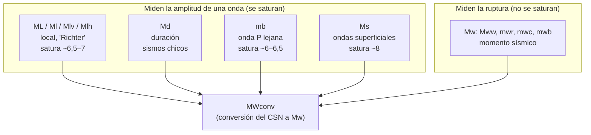
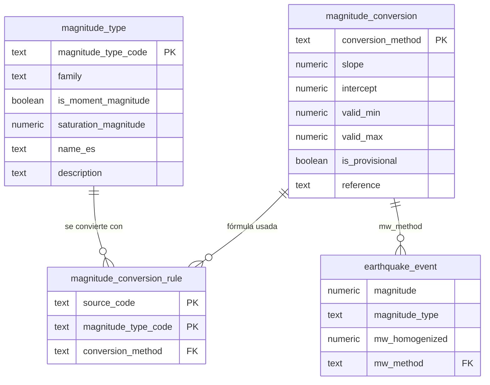

# Magnitudes sísmicas: qué es cada una y cómo las usamos

> Documento de apoyo del modelo lógico v2 ([MODELO_LOGICO_v2.md](MODELO_LOGICO_v2.md), secciones 4.5 y 5.3.1).
> Escrito el 2026-11-06. Todas las cifras salen de la base `sismos_chile` (57.531 eventos cargados) salvo que se indique otra fuente.
>
> Etiquetas: **[DATO]** = verificado en nuestra base · **[TEORÍA]** = definición sismológica estándar · **[DECISIÓN]** = elección nuestra, con su justificación.

---

## 0. Respuesta corta

1. **¿Todos los sismos vienen en Richter?** No. "Richter" es una sola de las escalas (la magnitud local, `ML`). En nuestra base hay **11 tipos distintos** de magnitud, contando las originales del catálogo histórico. Para sismos grandes la escala de Richter ni siquiera sirve, porque se "satura" cerca de 7.
2. **¿Cuál es la buena?** La **magnitud de momento (`Mw`)**. Mide el tamaño físico de la ruptura y no se satura. Es la que usan hoy el CSN y USGS para los sismos importantes, y es la que vamos a usar para comparar.
3. **¿"Mayor a 4" de qué?** Depende de la fuente:
   - **CSN histórico (1513–2025):** es **Mw ≥ 4**. El CSN ya convirtió todo a Mw (`MWconv`) y su catálogo solo trae eventos desde 4,0.
   - **CSN diario (desde 24-06-2025):** **no hay umbral**. La mayoría viene en magnitud local (`Ml`, `Mlv`), desde 2,0. Un "4" ahí no es un Mw 4.
   - **USGS "M≥4":** es la magnitud *preferida* de USGS, que en el 69 % de los casos es `mb`. Un `mb` 4,0 equivale a un **Mw ≈ 3,9**.
4. **¿Lo arreglamos?** Sí. Agregamos `mw_homogenized`: un Mw para cada evento donde se puede estimar con una fórmula confiable, más una columna `mw_method` que dice cómo se obtuvo. Las fórmulas **no las inventamos**: las reconstruimos desde el propio catálogo del CSN (sección 6).
5. **Regla práctica:** para comparar períodos o fuentes, usar `mw_homogenized >= 4.5`. Entre 4,0 y 4,5 el catálogo histórico trae muchos más sismos, pero **no por la escala**: integra boletines internacionales que las páginas diarias no publican (secciones 8 y 10).
6. **Estado [IMPLEMENTADO]:** 45.617 de 57.531 eventos (79 %) tienen `mw_homogenized`. Esto incluye casi todos los que tienen M ≥ 4. Los que quedan sin Mw son sismos chicos de las páginas diarias, que conservan su `Ml` original.
7. **Validación (sección 10):**
   - **La fórmula para `Ml` quedó validada.** El `Ml` de las páginas diarias es el mismo `ML` que el CSN convertía, y la fórmula reproduce su Mw con un error medio de +0,008.
   - **`Mlv` sigue provisional.** Es coherente en promedio, pero hay indicios de que da ~0,1 más alto.

---

## 1. Magnitud no es intensidad (y no existen los "grados Richter")

| | **Magnitud** | **Intensidad** |
|---|---|---|
| Qué mide | El **tamaño del sismo en su origen** (energía liberada) | **Cuánto se sintió** en un lugar |
| Cuántos valores | **Uno por sismo** (por escala) | **Uno por lugar**: es distinta en Santiago y en Concepción |
| Escala | Números decimales sin tope teórico (4,7; 8,8) | Números romanos I a XII (Mercalli Modificada) |
| Ejemplo | Maule 2010: **Mw 8,8** | Maule 2010: VIII–IX en Concepción, menos en Santiago |

"Grados Richter" es un error común. Los **grados** son de intensidad (Mercalli). La magnitud se dice "magnitud 6,2". La intensidad y los mapas ShakeMap se explican en la sección 4.7 del modelo lógico.

---

## 2. Lo que tienen en común todas las magnitudes

Todas son **logarítmicas** [TEORÍA]:

- **+1 de magnitud = la onda registrada es 10 veces más grande.**
- **+1 de magnitud = unas 32 veces más energía.** La relación de Gutenberg-Richter es `log₁₀ E = 1,5·M + 4,8`, con E en joules.
- **+0,2 de magnitud ≈ el doble de energía.**

| Comparación | Diferencia de M | Energía |
|---|---:|---:|
| M 5 vs M 4 | 1 | ~32 veces |
| M 7 vs M 5 | 2 | ~1.000 veces |
| Maule 8,8 vs M 7 | 1,8 | ~500 veces |
| Maule 8,8 vs M 4 | 4,8 | ~16 millones de veces |

Por eso una diferencia de "solo 0,3" entre dos escalas **no es un detalle**: es un sismo con el doble de energía.

---

## 3. Por qué existen tantas escalas

Cada escala mide **una onda distinta, con un instrumento distinto y a una distancia distinta**. Se fueron inventando porque cada una deja de funcionar en algún caso:

- **Distancia.** La escala de Richter se definió con sismógrafos a menos de ~600 km. Un sismo en Chile registrado en Japón necesita otra escala (`mb`, `Ms`).
- **Tamaño (saturación).** Cada escala mide la amplitud de una onda de cierto período. Los sismos muy grandes liberan su energía en ondas más largas que las que la escala "ve". Pasado cierto tamaño, **el número deja de crecer aunque el sismo sea mucho mayor**.

> **Analogía:** es como pesar camiones con una balanza de cocina. Hasta 5 kg funciona bien. Un auto y un camión marcan lo mismo: "5 kg (máximo)".

| Escala | Se satura aproximadamente en |
|---|---|
| `ML` (Richter) | 6,5 – 7 |
| `mb` | 6 – 6,5 |
| `Ms` | ~8 |
| **`Mw`** | **No se satura** |

**Consecuencia:** un `ML` 7 de 1950 y un `Mw` 8,8 de 2010 no se pueden ordenar con confianza si no se sabe la escala. Por eso la magnitud **siempre se guarda junto con su tipo**.

---

## 4. Ficha de cada escala

Una regla de notación: la mayúscula o minúscula en el código varía según la agencia (`Ml`, `ML`, `ml` son lo mismo). En la base normalizamos los códigos a minúsculas en la tabla `magnitude_type`.

### 4.1 `ML`, `Ml`: magnitud local, la "escala de Richter"

- **Quién y cuándo:** Charles Richter, 1935, para el sur de California.
- **Qué mide:** la amplitud máxima de la onda en un sismógrafo cercano, corregida por la distancia: `ML = log₁₀ A − log₁₀ A₀(distancia)`. Por definición, una amplitud de 1 mm a 100 km del epicentro en el sismógrafo de referencia (Wood-Anderson) equivale a ML 3.
- **Sirve para:** sismos chicos y medianos registrados por una red local o regional, como la red del CSN dentro de Chile.
- **Límites:** se satura sobre ~6,5. Cada red la calibra con su propia corrección de distancia, así que el `Ml` del CSN y el `ML` de otra red no son idénticos.
- **En nuestros datos [DATO]:** CSN diario `Ml` = 5.067 eventos (2,2 a 5,7). Antes del 24-06-2025, el CSN convertía su `ML` a Mw (sección 6).

### 4.2 `Mlv`, `Mlh`: magnitud local en componente vertical u horizontal

- **Qué es:** la misma idea de Richter, pero midiendo en la **componente vertical** (`v`) o en la **horizontal** (`h`) del sismógrafo moderno. Richter usaba la horizontal. Programas de procesamiento sísmico como SeisComP calculan ambas variantes.
- **Para nosotros:** es otra **variante de magnitud local**. Está en la misma familia que `Ml`, pero no es exactamente el mismo número.
- **En nuestros datos [DATO]:** `Mlv` = 7.406 y `Mlh` = 3. **El CSN reemplazó `Ml` por `Mlv` entre enero y marzo de 2026**:

  | Mes | `Ml` | `Mlv` |
  |---|---:|---:|
  | 2025-12 | 621 | 1 |
  | 2026-01 | 556 | 55 |
  | 2026-02 | 449 | 170 |
  | 2026-03 | 99 | 969 |
  | 2026-04 | 12 | 1.063 |

  No encontramos documentación pública del cambio. Las dos distribuciones se parecen mucho:

  | Tipo y período | Mediana | Percentil 90 | Percentil 99 | Eventos ≥4 |
  |---|---:|---:|---:|---:|
  | `Ml`, segundo semestre 2025 | 2,9 | 3,7 | 4,4 | 226 |
  | `Mlv`, abril a septiembre 2026 | 2,9 | 3,6 | 4,3 | 229 |

  Por eso aplicamos la misma fórmula a las dos. La validación (sección 10) confirmó la de `Ml`. La de `Mlv` queda **provisional**, porque hay indicios de que `Mlv` da ~0,1 más alto que `Ml` para el mismo sismo.

### 4.3 `Md`: magnitud de duración

- **Qué mide:** cuánto dura la señal (la "coda") en el sismógrafo. Un sismo más grande hace vibrar el registro por más tiempo.
- **Sirve para:** sismos chicos con una red local. Era útil cuando los instrumentos se saturaban con facilidad.
- **En nuestros datos [DATO]:** no está como magnitud preferida. Aparece como magnitud **original** en 4.999 eventos del CSN histórico (Universidad de Chile, 1989–2010), que el CSN ya convirtió a Mw.

### 4.4 `mb`: magnitud de ondas de cuerpo

- **Quién y cuándo:** Gutenberg, 1945.
- **Qué mide:** la amplitud de la **onda P** (la primera en llegar), con período de ~1 segundo, en estaciones **lejanas** (2.000 a 11.000 km).
- **Sirve para:** que una agencia global (USGS, ISC) mida rápido cualquier sismo del mundo sin tener estaciones cerca.
- **Límites:** **se satura entre 6 y 6,5.** Cada agencia la mide un poco distinto. En nuestra base, el `mb` del ISC y el `mb` de USGS (NEIC) necesitan fórmulas de conversión distintas (sección 6).
- **En nuestros datos [DATO]:**
  - 38 de los 42 eventos USGS de la muestra.
  - 8 eventos CSN diarios (`Mb`).
  - 23.804 eventos CSN históricos tenían `mb` como magnitud original, hoy convertidos.
  - En el catálogo USGS M≥4 completo (consulta del 2026-11-06), 21.172 de 30.487 eventos (69 %).

### 4.5 `Ms`: magnitud de ondas superficiales

- **Qué mide:** la amplitud de las **ondas superficiales** (Rayleigh) de ~20 segundos de período, en estaciones lejanas.
- **Sirve para:** sismos medianos y grandes poco profundos. Fue la escala "de los grandes" antes de 1977.
- **Límites:** se satura cerca de 8, y no funciona bien en sismos profundos.
- **En nuestros datos [DATO]:** 102 eventos históricos del CSN tenían `Ms` como magnitud original, hoy convertidos.

### 4.6 `Mw`: magnitud de momento, la escala de referencia

- **Quién y cuándo:** Kanamori (1977); Hanks y Kanamori (1979).
- **Qué mide:** no mide la amplitud de una onda. Mide el **momento sísmico M₀**, una cantidad física de la falla:

  ```
  M₀ = μ · A · D
       μ = rigidez de la roca  (~3·10¹⁰ Pa)
       A = área de la falla que se rompió (m²)
       D = deslizamiento promedio (m)

  Mw = (2/3) · (log₁₀ M₀ − 9,1)      con M₀ en N·m
  ```

  **Ejemplo:** el terremoto del Maule 2010 rompió unos 500 km × 100 km de falla con un deslizamiento promedio de varios metros. Eso da un M₀ ≈ 1,8·10²² N·m y un **Mw ≈ 8,8**.
- **Por qué es la mejor:** **no se satura**, porque crece con el tamaño real de la ruptura. Además, sus constantes se eligieron para que coincida con las escalas antiguas en su rango útil. Un Mw 5 es "parecido" a un ML 5.
- **Variantes** (todas son Mw; las letras finales dicen **cómo** se calculó M₀):

| Código | Método | Típico para |
|---|---|---|
| `Mww` | Fase W: onda de período muy largo que llega entre la P y la S (Kanamori y Rivera, 2008). Se calcula rápido. | Sismos grandes (M ≳ 5,5). Estándar de USGS para eventos importantes |
| `mwr` | Tensor de momento **regional** (estaciones a menos de ~2.000 km) | Sismos medianos (M ~3,5–6) |
| `mwc` | Tensor de momento **centroide** (ondas largas globales, estilo Global CMT) | Sismos M ≳ 5 |
| `mwb` | Tensor de momento con **ondas de cuerpo** | Sismos M ~5,5–7 |
| `Mw` | Mw genérica, sin indicar el método | — |

- **En nuestros datos [DATO]:**
  - CSN diario: `Mw` 259 (3,9 a 5,7) y `Mww` 29 (5,2 a 7,8). El CSN publica Mw para casi todos sus eventos grandes.
  - USGS: `mwr` 4.
  - En el CSN histórico, 9.545 eventos ya tenían Mw original (ISC-GEM, Global CMT, NEIC, Universidad de Chile, entre otros).

### 4.7 `MWconv`: Mw convertida por el CSN

- **Qué es:** **no es una escala sismológica**. Es una **columna del catálogo histórico del CSN** (`catalogo_csn.csv`). Allí el CSN tomó la magnitud original de cada evento (que puede ser `mb`, `ML`, `Md`, `Ms` o `Mw`, de distintas agencias) y la llevó a Mw con una fórmula.
- **En nuestros datos [DATO]:** los **44.691 eventos históricos** (1513 a 23-06-2025) tienen `MWconv` como magnitud preferida. La magnitud original se conserva en `reported_magnitude`, `reported_magnitude_type` y `magnitude_agency`.
- **Hallazgo:** reconstruimos exactamente qué fórmula usó el CSN para cada tipo y agencia (sección 6).

### 4.8 `M`: sin especificar

- Magnitud sin tipo declarado. Pasa en eventos antiguos o en reportes rápidos.
- **En nuestros datos [DATO]:** 26 eventos CSN diarios (2,4 a 4,3). **No se convierten**: sin saber la escala, cualquier fórmula sería inventada.

### 4.9 Resumen visual



---

## 5. ¿Y la "escala de Richter" de las noticias?

- Técnicamente, "Richter" = `ML`, la magnitud local de 1935.
- En el lenguaje común se dice "escala de Richter" para **cualquier magnitud**. Cuando las noticias dicen que el terremoto del Maule fue "8,8 Richter", ese 8,8 es en realidad **Mw**. Con la escala de Richter original habría marcado cerca de 7, porque se satura.
- Para sismos **chicos** (M < 5), lo que publica el CSN sí es de la familia Richter (`Ml`, `Mlv`).
- Para sismos **grandes**, el CSN y USGS publican `Mw` o `Mww`.

**Cómo decirlo en el informe:** "las agencias reportan distintos tipos de magnitud. Para sismos pequeños, la magnitud local (equivalente moderna de la escala de Richter); para los mayores, la magnitud de momento (Mw). Para comparar, el sistema estima un Mw homogéneo."

---

## 6. Hallazgo: las fórmulas que usó el CSN para su `MWconv`

### 6.1 Cómo lo descubrimos

En cada evento del CSN histórico tenemos la magnitud original (`reported_magnitude`, por ejemplo `mb` 4,5 del ISC) y la convertida (`magnitude` = `MWconv`). Si la conversión fue una fórmula lineal `Mw = a·m + b`, una regresión debería reproducirla casi sin error. Para cada combinación de tipo y agencia se calculó:

```sql
SELECT reported_magnitude_type, magnitude_agency, count(*),
       regr_slope(magnitude, reported_magnitude)     AS a,
       regr_intercept(magnitude, reported_magnitude) AS b,
       regr_r2(magnitude, reported_magnitude)        AS r2
FROM seismic.earthquake_event
WHERE source_code = 'csn' AND magnitude_type = 'MWconv'
GROUP BY 1, 2;
```

### 6.2 Resultado [DATO]

El **error máximo es ≤ 0,008** en todas las combinaciones con más de 40 eventos. Eso es solo el redondeo a 2 decimales. **El CSN aplicó una fórmula lineal fija para cada tipo y agencia, y la recuperamos exactamente:**

| Magnitud original | Agencia | Eventos | Período | Fórmula del CSN | Error máx. |
|---|---|---:|---|---|---:|
| `mb` | ISC | 18.447 | 1964–2023 | Mw = 1,0708·mb − 0,2631 | 0,005 |
| `mb` | **NEIC (USGS)** | 5.013 | 1964–2025 | **Mw = 1,1504·mb − 0,7327** | 0,006 |
| `Md` | GUC (U. de Chile) | 4.961 | 1989–2010 | Mw = 1,0651·Md − 0,0514 | 0,008 |
| `ML` | **GUC (U. de Chile / CSN)** | 4.602 | 2001–2025 | **Mw = 0,9575·ML + 0,2412** | 0,006 |
| `Ms` | **NEIC (USGS)** | 57 | 1969–2000 | **Mw = 0,6801·Ms + 2,0390** | 0,004 |
| `Ms` | ISC | 45 | 1971–2023 | Mw = 0,6807·Ms + 2,0375 | 0,005 |
| `mb` | otras (VAO, EIDC, GFZ) | 344 | — | fórmulas propias de cada agencia | ≤ 0,007 |
| `ML` | otras (SJA, ARE) | 199 | — | fórmulas propias de cada agencia | ≤ 0,007 |
| `Mw` | ISC-GEM, GUC, NEIC, GCMT, SARA | 7.810 | 1520–2025 | **Mw = Mw** (sin cambio) | 0,000 |

**Qué nos dice esto:**

1. **El catálogo histórico ya es Mw homogéneo.** Por eso `MWconv` se usa tal cual (método `csn_mwconv`).
2. **Tenemos la fórmula del propio CSN para pasar su `ML` a Mw:** `Mw = 0,9575·ML + 0,2412`, calibrada con 4.602 eventos entre 2001 y junio de 2025. Es justo lo que faltaba para los `Ml`/`Mlv` de las páginas diarias. Así ya no dependemos de emparejar con USGS para tener una primera estimación.
3. **Tenemos la fórmula del CSN para el `mb` de USGS (NEIC).** Los eventos USGS con `mb` quedan en la misma escala que el catálogo CSN.
4. **El `mb` de cada agencia es distinto.** A `mb` 4,0, ISC da Mw 4,02 y NEIC da Mw 3,87. Por eso la fórmula depende de la agencia.
5. **Comprobación externa:** para `Ms`, la fórmula del CSN (0,680·Ms + 2,04) es casi igual a la relación global de Scordilis (2006), 0,67·Ms + 2,07. Esto da confianza en que el CSN siguió relaciones publicadas.

### 6.3 ¿Por qué no usar directamente las fórmulas globales de Scordilis (2006)?

El diseño anterior proponía Scordilis para `mb`. Al compararlas:

| `mb` | Scordilis (global): 0,85·mb + 1,03 | CSN para NEIC: 1,1504·mb − 0,7327 | Diferencia |
|---:|---:|---:|---:|
| 4,0 | 4,43 | 3,87 | **0,56** |
| 4,5 | 4,86 | 4,44 | 0,42 |
| 5,0 | 5,28 | 5,02 | 0,26 |
| 6,0 | 6,13 | 6,17 | −0,04 |

**[DECISIÓN]** Usamos las fórmulas del CSN. Hay tres razones:

- Con ellas, todo lo que convertimos queda **en la misma escala que el 77 % de la base** (el `MWconv` histórico).
- Están calibradas con sismos chilenos.
- Con Scordilis, un `mb` 4,0 de USGS pasaría a Mw 4,43, mientras que el mismo `mb` en el catálogo CSN quedó en 3,87. Contaríamos como "M≥4" en USGS eventos que el CSN considera menores a 4.

Scordilis queda documentado como alternativa para un análisis de sensibilidad.

---

## 7. ¿"Mayor a 4" de qué? Lo que realmente filtramos

| Dónde aparece el "4" | Qué significa realmente | Equivale en Mw a |
|---|---|---|
| **Catálogo histórico CSN** (todo lo anterior al 24-06-2025) | El CSN solo publica eventos con `MWconv` ≥ 4,0. El mínimo en la base es 3,97 por redondeo de la conversión. | **Mw ≥ 4** (convertida) |
| **Páginas diarias CSN** (desde el 24-06-2025) | **No hay umbral.** Vienen desde 2,0. Un "≥ 4" ahí mezcla `Ml`/`Mlv` (592 eventos) con `Mw`/`Mww` (286). | `Ml` 4,0 ≈ Mw 4,07 |
| **USGS "M≥4"** (descarga diseñada de 30.959 eventos) | `minmagnitude=4` filtra la **magnitud preferida** de USGS, sea del tipo que sea: 69 % `mb`. | `mb` 4,0 ≈ **Mw 3,87**; `mww` 4,0 = Mw 4,0 |
| **Muestra USGS actual** (42 eventos) | Se pidió M≥2,5. Son `mb` 4,0–4,7 y `mwr`. | — |
| **Consulta 3** de `queries.sql` (comunas con M≥5) | Filtra `magnitude` cruda. Mezcla `MWconv` con `Ml`. | Se corrige usando `mw_homogenized` |

**Para la descarga completa de USGS:** pedir "M≥4" **sí sirve**. Trae todos los `mb` ≥ 4,0 (que equivalen a Mw ≥ 3,87) y todos los Mw ≥ 4. Después se filtra con `mw_homogenized >= 4`. Lo que no se debe hacer es tratar el "M≥4" de USGS como si fuera Mw ≥ 4.

---

## 8. ¿Cuánto afecta? Comparación antes y después del 24-06-2025

**Aclaración importante.** El 24-06-2025 **el CSN no cambió de escala**: sus páginas diarias ya publicaban `Ml` antes (7.633 de 7.880 eventos entre junio de 2024 y junio de 2025). Lo que cambia en esa fecha es **qué producto del CSN usamos**: hasta el 23-06-2025 la base tiene el catálogo histórico (`MWconv`), y desde el 24-06-2025 las páginas diarias.

Comparamos un año del CSN antes del cambio y un año después [DATO]. Las columnas "Mw" son `mw_homogenized`, calculado con las fórmulas de la sección 6:

| CSN, un año | M ≥ 4 crudo | **Mw ≥ 4** | Mw ≥ 4 a ≤ 100 km de Chile | Mw ≥ 4 a > 100 km | **Mw ≥ 4,5** | **Mw ≥ 5** |
|---|---:|---:|---:|---:|---:|---:|
| 24-06-2024 a 23-06-2025 (histórico, `MWconv`) | 983 | 983 | 786 | 197 | **252** | **67** |
| 24-06-2025 a 23-06-2026 (diario, `Ml`/`Mlv`/`Mw`) | 703 | 698 | 643 | 55 | **229** | **66** |

**Cómo leerlo:**

- **Sobre Mw 4,5 los dos períodos son parecidos** (252 y 229; 67 y 66). Ahí las escalas ya son comparables.
- **Entre 4,0 y 4,5 el histórico tiene ~280 eventos más.** La validación (sección 10) mostró que **no es un problema de escala sino de cobertura del catálogo**:
  - En el **mismo año** 2024–2025, las páginas diarias tienen 638 sismos Mw ≥ 4 y el histórico 983.
  - Comparando producto con producto, las páginas diarias de 2024–2025 (638) y las de 2025–2026 (698) sí son comparables.
  - 222 eventos del histórico de ese año no aparecen en las páginas diarias. 165 de ellos están a más de 100 km de Chile (Argentina, Bolivia, Perú, mar adentro), y casi todos vienen de boletines internacionales (156 con `mb` de NEIC). El CSN los integra al catálogo histórico, pero no los publica como reporte diario.
- **El total crudo engaña doblemente:** 985 eventos en el año histórico contra 9.659 en el diario. No es que haya 10 veces más sismos. El histórico **solo trae M ≥ 4** y el diario trae todo desde 2,0.

**[DECISIÓN] Reglas para las consultas del proyecto:**

1. Para comparar magnitudes entre fuentes o períodos, usar siempre **`mw_homogenized`**, no `magnitude`.
2. Para **contar** sismos a través del 24-06-2025 o entre fuentes, usar **`mw_homogenized >= 4.5`**.
3. Para tendencias de largo plazo, recordar que el catálogo histórico también cambia de completitud. En los años 60 tiene 1.778 eventos por década y en los 2010 tiene 15.082, porque aumentaron las estaciones, no los sismos. Para décadas antiguas conviene un umbral más alto (Mw ≥ 5).
4. `magnitude` sigue siendo el **valor publicado por la fuente**. No se modifica nunca.

**Para contar sismos de Chile a través del 24-06-2025** hay dos caminos. Uno es usar `mw_homogenized >= 4.5`, donde la diferencia es chica (252 contra 229). El otro es filtrar `distance_km <= 100`, que saca la mayoría de los eventos internacionales que solo trae el histórico (786 contra 643 con Mw ≥ 4).

---

## 9. Cómo queda en el modelo [IMPLEMENTADO]

### 9.1 Tablas y columnas



| Objeto | Qué guarda | Por qué así |
|---|---|---|
| `magnitude_type` | Catálogo de tipos (`mw`, `mww`, `mb`, `ml`, `mlv`...): familia, si ya es Mw, dónde se satura y una explicación en español | Las definiciones de este documento quedan **dentro de la base** y se pueden consultar |
| `magnitude_conversion` | Cada fórmula `Mw = a·m + b`, con su rango válido, si es provisional y de dónde sale | **Las fórmulas son datos, no código.** Para cambiar una calibración basta un `UPDATE` y volver a calcular |
| `magnitude_conversion_rule` | Qué fórmula se usa para cada **fuente + tipo** (ej. `usgs` + `mb` → fórmula NEIC) | El mismo código (`ml`, `mb`) significa cosas distintas según la agencia |
| `earthquake_event.mw_homogenized` | El Mw estimado (o NULL si no se puede estimar con confianza) | Una sola columna comparable para todas las consultas |
| `earthquake_event.mw_method` | Qué fórmula produjo ese Mw | Trazabilidad: siempre se sabe si un valor es nativo, del CSN o provisional |

### 9.2 Métodos de conversión

| `mw_method` | Se aplica a | Fórmula | Rango válido | ¿Provisional? |
|---|---|---|---|---|
| `native` | `Mw`, `Mww`, `mwr`, `mwc`, `mwb` de cualquier fuente | Mw = M | sin límite | No |
| `csn_mwconv` | CSN histórico | Mw = MWconv (ya convertida por el CSN) | sin límite | No |
| `csn_relation_mb_neic` | `mb` de USGS y `Mb` del CSN diario | Mw = 1,1504·mb − 0,7327 | 4,1 – 6,1 | No |
| `csn_relation_ms_neic` | `Ms` de USGS | Mw = 0,6801·Ms + 2,0390 | 3,8 – 5,9 | No |
| `csn_relation_ml` | `Ml` del CSN diario | Mw = 0,9575·Ml + 0,2412 | 4,0 – 5,4 | No (validada, sección 10) |
| `csn_relation_mlv_provisional` | `Mlv`, `Mlh` del CSN diario | Mw = 0,9575·Mlv + 0,2412 | 4,0 – 5,4 | **Sí** |
| *(NULL)* | `M` sin tipo, `md`/`ml` de USGS, y valores fuera de rango | — | — | — |

**[DECISIÓN] No extrapolamos.** Cada fórmula se aplica solo dentro del rango de magnitudes con que el CSN la usó. Un `Ml` 2,5 queda con `mw_homogenized` NULL, porque la fórmula nunca se probó con sismos tan chicos. Para el umbral de Mw 4 esto no cambia nada: un `Ml` 3,9 da Mw 3,97, que igual queda bajo 4.

El costo de esta regla son los 3 `Ml` sobre 5,4 de las páginas diarias, que quedan sin Mw. La validación de la sección 10 solo tuvo pares hasta `Ml` 5,3, así que no justifica ampliar el rango. Si más adelante hubiera evidencia, bastaría un `UPDATE` a `magnitude_conversion` y volver a ejecutar el script.

**[DECISIÓN] Por qué `magnitude_estimate` sigue [DISEÑADO].** Hoy cada evento trae como máximo dos magnitudes (la preferida y la original), y ya están en `earthquake_event`. Crear la tabla 1:N ahora solo duplicaría esas columnas. Se implementará cuando la descarga completa de USGS traiga varias magnitudes por evento (por ejemplo `mb` y `Mww` del mismo sismo).

### 9.3 Cómo se calcula

El script [`db/homogenize_magnitudes.sql`](../db/homogenize_magnitudes.sql) hace esto:

1. Registra en `magnitude_type` cualquier tipo nuevo que aparezca, como `unknown`, para no perder datos.
2. Para cada evento busca su regla (fuente + tipo) y su fórmula. Si la magnitud está dentro del rango válido, calcula `round(a·m + b, 2)`.
3. Solo reescribe las filas cuyo valor cambió. Es idempotente.

`scripts/load_catalogs_postgis.ps1` lo ejecuta automáticamente después de cada carga.

### 9.4 Resultado [DATO]

Ejecutado el 2026-11-06 sobre los 57.531 eventos. Tardó 1,8 s. Una segunda ejecución actualizó 0 filas, así que es idempotente.

| Fuente | `mw_method` | Eventos | Mw mín. | Mw máx. |
|---|---|---:|---:|---:|
| CSN | `csn_mwconv` | 44.691 | 3,97 | 9,55 |
| CSN | `csn_relation_ml` | 287 | 4,07 | 5,22 |
| CSN | `csn_relation_mlv_provisional` | 302 | 4,07 | 5,12 |
| CSN | `native` | 288 | 3,90 | 7,80 |
| CSN | `csn_relation_mb_neic` | 8 | 4,67 | 6,05 |
| CSN | *(sin Mw)* | 11.913 | — | — |
| USGS | `csn_relation_mb_neic` | 37 | 3,98 | 4,67 |
| USGS | `native` | 4 | 4,20 | 4,70 |
| USGS | *(sin Mw)* | 1 | — | — |
| **Total con Mw** | | **45.617 (79 %)** | | |

- **Los 11.913 eventos CSN sin Mw** son casi todos sismos diarios chicos (`Ml`/`Mlv` < 4,0), fuera del rango de la fórmula. Su magnitud publicada sigue disponible en `magnitude`.
- **De los 45.616 eventos con magnitud publicada ≥ 4, solo 6 quedan sin Mw:**
  - 3 `Ml` sobre 5,4 (5,5, 5,7 y 5,7), fuera del rango calibrado;
  - 2 `M` sin tipo;
  - 1 `mb` 4,0 de USGS, bajo el rango.
- **Cuánto cambia el valor:** las conversiones mueven la magnitud entre −0,12 y +0,15. En promedio, +0,06 para `Ml` y −0,05 para `mb`. Son cambios chicos por evento, pero desplazan los umbrales (ver sección 8).

### 9.5 Cómo consultar

```sql
-- Sismos Mw >= 5 comparables entre fuentes, con el método usado
SELECT occurred_at, source_code, magnitude, magnitude_type,
       mw_homogenized, mw_method
FROM seismic.earthquake_event
WHERE mw_homogenized >= 5
ORDER BY occurred_at DESC;

-- Excluir las estimaciones provisionales (análisis más conservador)
SELECT count(*)
FROM seismic.earthquake_event AS e
JOIN seismic.magnitude_conversion AS c ON c.conversion_method = e.mw_method
WHERE e.mw_homogenized >= 4.5
  AND NOT c.is_provisional;

-- Qué significa cada tipo de magnitud
SELECT magnitude_type_code, name_es, family, saturation_magnitude
FROM seismic.magnitude_type
ORDER BY family, magnitude_type_code;
```

---

## 10. Validación de la fórmula `Ml` → Mw (2026-11-06)

### 10.1 Qué se hizo

La fórmula `Mw = 0,9575·Ml + 0,2412` salió del catálogo histórico (2001–2025). La pregunta era si sirve para el `Ml`/`Mlv` que publican hoy las páginas diarias. Se hicieron dos pruebas independientes:

| Prueba | Datos | Idea |
|---|---|---|
| **1. Contra el propio CSN** | 365 páginas diarias del CSN del **24-06-2024 al 23-06-2025** (7.880 eventos), un año en que también existe el catálogo histórico | El mismo sismo aparece con su `Ml` diario y con su `MWconv` histórico. Si la fórmula es correcta, `MWconv ≈ fórmula(Ml)`. |
| **2. Contra USGS** | 1.018 eventos USGS M≥3,5 del 24-06-2025 al 22-09-2026 | Es la única forma de probar `Mlv`, que solo existe desde 2026 y no tiene par en el histórico. |

**Emparejamiento:** se considera el mismo sismo si la diferencia de hora es ≤ 60 s y los epicentros están a ≤ 100 km (`ST_DWithin` sobre `geography`). Si hay varios candidatos, se toma el más cercano en tiempo. Los pares reales quedaron mucho más cerca: 0,1 s y 0–3 km en promedio.

**Cómo reproducirlo:**

```powershell
python scripts\validate_ml_conversion.py      # descarga a data\diagnostics\magnitude_validation\
$d = (Resolve-Path data\diagnostics\magnitude_validation).Path.Replace('\','/')
& 'C:\Program Files\PostgreSQL\18\bin\psql.exe' -h 127.0.0.1 -p 5433 -U sismos_app -d sismos_chile `
  -v "csn_csv=$d/csn_daily_20240624_20250623.csv" -v "usgs_csv=$d/usgs_m3.5_20250624_20260922.csv" `
  -f db\validate_ml_conversion.sql
```

El SQL crea un esquema aparte, `validation`, con los pares (`pair_historical`, `pair_usgs`). No toca el esquema `seismic`.

### 10.2 Resultados [DATO]

**a) El `Ml` diario es el mismo `ML` que convertía el CSN.** En los 84 pares cuyo `MWconv` salió de un `ML` de la Universidad de Chile (GUC), el valor de la página diaria es **idéntico en 77** y la diferencia media es −0,001. La fórmula se aplica, entonces, exactamente a la magnitud para la que fue hecha.

**b) La fórmula reproduce el Mw del catálogo histórico.** Residuo = Mw de referencia − fórmula(`Ml`), con `Ml` ≥ 4:

| Referencia (de dónde salió el Mw) | Tipo CSN | Pares | Residuo medio | Desviación |
|---|---|---:|---:|---:|
| Histórico: `ML` GUC (por construcción) | `Ml` | 82 | −0,002 | 0,030 |
| **Histórico: `mb` NEIC convertido** | `Ml` | **205** | **+0,022** | 0,165 |
| Histórico: `Mw` NEIC | `Ml` | 26 | −0,133 | 0,170 |
| USGS 2025–2026: `mb` convertido (fórmula NEIC) | `Ml` | 181 | +0,013 | 0,177 |
| USGS 2025–2026: `mb` convertido (fórmula NEIC) | **`Mlv`** | **147** | **−0,035** | 0,203 |
| USGS 2025–2026: `mwr` | `Ml` | 28 | −0,166 | 0,187 |
| USGS 2025–2026: `mwr` | **`Mlv`** | **35** | **−0,330** | 0,156 |

Por tramo de `Ml` contra el `MWconv` histórico, el tramo 4,0–4,5 tiene 315 pares y un residuo de **+0,008 ± 0,145**. Bajo 4,0 el residuo sale positivo (+0,33 en 3,5–4,0), pero es un **sesgo de selección**: el histórico solo incluye eventos con Mw ≥ 4, así que solo se emparejan los `Ml` chicos que "salieron grandes". Por eso la fórmula se aplica desde `Ml` 4,0.

**c) Ojo con `mwr`.** Comparando Mw con Mw en el mismo sismo, el `mwr` de USGS queda **0,21 por debajo del Mw del CSN** (77 pares), mientras que el `mww` de USGS coincide (−0,05; 39 pares). Por eso el residuo contra `mwr` no mide solo la fórmula: también incluye esa diferencia entre agencias.

**d) La diferencia de conteos es de catálogo, no de escala.** En el mismo año 2024–2025:

| Producto CSN, 24-06-2024 a 23-06-2025 | Mw ≥ 4 | Mw ≥ 4,5 | Mw ≥ 5 |
|---|---:|---:|---:|
| Páginas diarias (con nuestra fórmula) | 638 | 246 | 72 |
| Catálogo histórico (`MWconv`) | 983 | 252 | 67 |

222 eventos del histórico no tienen página diaria. 165 de ellos están a más de 100 km de Chile y 156 vienen de `mb` de NEIC. Son sismos de la región tomados de boletines internacionales. Las páginas diarias de 2025–2026 dan 698 eventos Mw ≥ 4, coherentes con las 638 de 2024–2025.

### 10.3 Conclusión [DECISIÓN]

| Magnitud | Veredicto | Método en la base |
|---|---|---|
| `Ml` | **Validada.** Es el mismo `ML` del histórico y el sesgo es < 0,03 contra el `MWconv` del CSN, en dos períodos y con dos referencias independientes. | `csn_relation_ml` (no provisional) |
| `Mlv`, `Mlh` | **Provisional.** Contra `mb` convertido es coherente (−0,035), pero contra `mwr` queda 0,16 más alta que `Ml` (−0,33 contra −0,17). Esto sugiere que `Mlv` da ~0,05–0,15 más alto que `Ml` para el mismo sismo. Con 35 pares no alcanza para recalibrar. | `csn_relation_mlv_provisional` |

**Cuánto importa:** el error individual de cualquier conversión es de ±0,15–0,20 (la desviación). Sirve para conteos y estadísticas, no para afirmar que un sismo puntual fue "4,3 y no 4,2". Si `Mlv` estuviera 0,1 alta, desde 2026 se contarían algo más de sismos Mw ≥ 4. Los conteos de Mw ≥ 4,5 y ≥ 5 casi no cambian, porque ahí el CSN publica sobre todo `Mw` nativo.

**Qué sigue para cerrar `Mlv`:** cuando se descargue USGS completo, habrá más pares con `mww`. Esa es la referencia que coincide con el Mw del CSN. Con ellos se puede calibrar una fórmula propia para `Mlv` y cambiarla con un `UPDATE` en `magnitude_conversion`.

**Una observación sobre "Mw verdadero":** contra Mw físico (`Mw` de NEIC, `mwr`), la fórmula da en promedio 0,13–0,17 más alto en el rango 4–4,5. Eso **no es un error de nuestra conversión**: refleja cómo el CSN armó su `MWconv` histórico. Nuestro objetivo es que todo quede **en la misma escala que el catálogo del CSN**, y eso se cumple. Si algún día se quisiera Mw físico estricto, habría que recalibrar el catálogo completo, no solo esta fórmula.

---

## 11. Glosario rápido

| Término | Significado |
|---|---|
| **Magnitud** | Tamaño del sismo en su origen. Un valor por sismo y por escala. |
| **Intensidad** | Cuánto se sintió en un lugar (Mercalli, I–XII). |
| **Saturación** | Cuando una escala deja de crecer aunque el sismo sea mayor. |
| **Momento sísmico (M₀)** | Rigidez × área de ruptura × deslizamiento. Base de Mw. |
| **Mw** | Magnitud de momento. No se satura. Es la referencia. |
| **ML / Richter** | Magnitud local de 1935, para sismos cercanos y chicos. |
| **Mlv / Mlh** | Magnitud local medida en la componente vertical u horizontal. |
| **mb / Ms** | Magnitudes de ondas de cuerpo y de superficie, medidas a distancia. |
| **MWconv** | Columna del catálogo CSN: la magnitud original convertida a Mw. |
| **`mw_homogenized`** | Nuestra estimación de Mw para comparar todo en la misma escala. |
| **Completitud (Mc)** | Magnitud mínima sobre la cual un catálogo registra *todos* los sismos. Cambia con el tiempo y entre fuentes. |
| **Agencia** | Quién midió la magnitud: ISC (Reino Unido), NEIC (USGS), GCMT (Global CMT), ISC-GEM, GUC (Universidad de Chile / CSN), GFZ (Alemania). |

---

## 12. Referencias

- Richter, C. F. (1935). An instrumental earthquake magnitude scale. *BSSA*, 25(1), 1–32.
- Gutenberg, B. (1945). Amplitudes of P, PP, and S and magnitude of shallow earthquakes. *BSSA*, 35, 57–69.
- Kanamori, H. (1977). The energy release in great earthquakes. *JGR*, 82(20), 2981–2987.
- Hanks, T. C. y Kanamori, H. (1979). A moment magnitude scale. *JGR*, 84(B5), 2348–2350.
- Kanamori, H. y Rivera, L. (2008). Source inversion of W phase. *Geophysical Journal International*, 175, 222–238.
- Scordilis, E. M. (2006). Empirical global relations converting MS and mb to moment magnitude. *Journal of Seismology*, 10, 225–236.
- Poulos, A. et al. (2019). Modelo de recurrencia de la sismicidad de subducción chilena, *BSSA*. Ejemplo de homogeneización a Mw de catálogos chilenos, con regresiones Ms/ML/mb → Mw: <https://ajpoulos.github.io/assets/pdf/Poulos_et_al_2019_BSSA.pdf>
- USGS. Magnitude types: <https://www.usgs.gov/programs/earthquake-hazards/magnitude-types>
- Centro Sismológico Nacional. Catálogo sísmico (`catalogo_csn.csv`): <https://www.sismologia.cl/sismicidad/catalogo/>. No encontramos documentación pública de las fórmulas de `MWconv`; las de la sección 6 se dedujeron de los datos.
