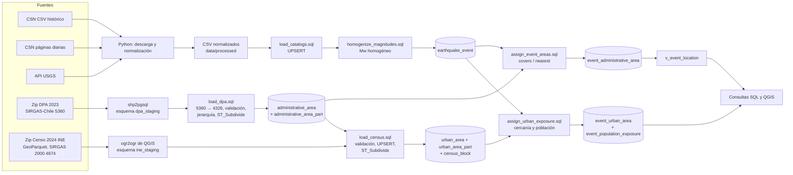

# Modelo lógico v2 y carga de datos (Entrega 2)

**Proyecto:** Sistema espacial de sismicidad en Chile
**Equipo:** Gabriel Huerta, Ignacio Barría
**Fecha del documento:** 2026-11-06 (zonas urbanas y población agregadas el 2026-11-07)
**Entrega a la que apoya:** Proyecto 2, "Representación de datos y visualización" (9-11-2026)

Este documento explica **qué cambió en el modelo de datos después del Hito 1, por qué cambió, cómo se cargaron los datos y qué queda para las etapas siguientes**. Está escrito para que cualquiera de los dos integrantes pueda reconstruir el razonamiento sin haber estado en la sesión de trabajo.

---

## Contenido

0. [Cómo leer este documento](#0-cómo-leer-este-documento)
1. [Resumen en una página](#1-resumen-en-una-página)
2. [Qué pide la Entrega 2 y dónde está cada cosa](#2-qué-pide-la-entrega-2-y-dónde-está-cada-cosa)
3. [Punto de partida: el modelo del Hito 1 y sus problemas](#3-punto-de-partida-el-modelo-del-hito-1-y-sus-problemas)
4. [Conceptos necesarios para entender el modelo](#4-conceptos-necesarios-para-entender-el-modelo)
5. [Modelo lógico v2](#5-modelo-lógico-v2)
6. [Sistema donde se almacenan los datos](#6-sistema-donde-se-almacenan-los-datos)
7. [Carga de datos](#7-carga-de-datos)
8. [Consultas básicas](#8-consultas-básicas)
9. [Decisiones de diseño y alternativas descartadas](#9-decisiones-de-diseño-y-alternativas-descartadas)
10. [Limitaciones conocidas](#10-limitaciones-conocidas)
11. [Etapas siguientes](#11-etapas-siguientes)
12. [Glosario](#12-glosario)
13. [Referencias](#13-referencias)

---

## 0. Cómo leer este documento

Cada tabla y cada idea lleva una de estas dos etiquetas:

| Etiqueta | Significado |
|---|---|
| **[IMPLEMENTADO]** | Existe en `db/schema.sql`, está creada en la base y tiene datos cargados al 2026-11-07. |
| **[DISEÑADO]** | Está especificada aquí, pero todavía **no existe** en la base. Es trabajo de las etapas siguientes (sección 11). |

Esta distinción importa para el informe y la presentación: la Entrega 2 exige mostrar **datos ingresados y consultas funcionando**, así que solo se puede afirmar como hecho lo marcado **[IMPLEMENTADO]**. Lo **[DISEÑADO]** se presenta como "diseño del modelo para las próximas etapas".

Archivos del repositorio que se mencionan:

| Archivo | Para qué sirve |
|---|---|
| `db/schema.sql` | Crea o actualiza todas las tablas, índices y la vista. Se puede ejecutar muchas veces sin romper nada. |
| `db/load_catalogs.sql` + `scripts/load_catalogs_postgis.ps1` | Cargan los sismos de CSN y USGS. |
| `db/load_dpa.sql` + `scripts/load_dpa_postgis.ps1` | **Nuevos.** Cargan regiones, provincias y comunas de la DPA 2023. |
| `db/assign_event_areas.sql` | **Nuevo.** Asigna cada sismo a una comuna. |
| `db/homogenize_magnitudes.sql` | **Nuevo.** Calcula el Mw homogéneo de cada sismo (sección 4.5). |
| `scripts/validate_ml_conversion.py` + `db/validate_ml_conversion.sql` | **Nuevos.** Descargan y cruzan los datos que validan la fórmula `Ml` → Mw ([MAGNITUDES.md](MAGNITUDES.md), sección 10). |
| `db/load_census.sql` + `scripts/load_ine_manzanas_postgis.ps1` | **Nuevos.** Cargan las zonas urbanas y las manzanas del Censo 2024 (INE). El script lo preparó Ignacio y se integró con correcciones. |
| `db/assign_urban_exposure.sql` | **Nuevo.** Calcula las zonas urbanas cercanas a cada sismo y la población a 25, 50 y 100 km. |
| `db/queries.sql` | **Reescrito.** Contiene las 14 consultas básicas de la sección 8. |
| `docs/MAGNITUDES.md` | **Nuevo.** Explicación completa de las escalas de magnitud y de su conversión a Mw. |
| `docs/INE_CENSO2024.md` | **Nuevo.** Guía completa del Censo 2024: qué datos se usan, cómo se cargan, cómo se mide la cercanía y resultados. |

---

## 1. Resumen en una página

**Qué teníamos en el Hito 1.** Había un modelo conceptual de 5 entidades: FUENTE, INGESTION_RUN, EVENTO_SISMICO, REGION y COMUNA. Habíamos cargado 57.531 sismos (CSN y USGS), pero **ningún límite administrativo**. Por eso no se podía responder la pregunta central del proyecto, "¿qué regiones concentran más sismos?".

**Qué se hizo para la Entrega 2 [IMPLEMENTADO]:**

1. **Se cargó la DPA 2023 oficial** (SUBDERE / IDE Chile): 16 regiones, 56 provincias y 345 comunas, reproyectadas de SIRGAS-Chile (EPSG:5360) a WGS 84 (EPSG:4326). Las superficies que calcula PostGIS coinciden con las oficiales al km² (sección 7.5).
2. **Regiones, provincias y comunas quedaron en una sola tabla con jerarquía**: cada comuna apunta a su provincia y cada provincia a su región.
3. **Cada uno de los 57.531 sismos quedó asignado a una comuna**:
   - 23.156 (40 %) tienen el epicentro dentro de una comuna.
   - 34.375 (60 %) están en el mar o fuera de Chile y se asignaron a la comuna más cercana, guardando la distancia en km.
4. **Se agregó una tabla técnica de trozos de comuna** (`ST_Subdivide`). Gracias a ella, la asignación de todos los sismos tarda unos 45 segundos y cada consulta, milisegundos.
5. **Se reescribieron las consultas básicas** (por región, comuna, distancia, profundidad, densidad y tipo de magnitud). Las 10 corren en total en menos de 1 segundo.
6. **Magnitudes comparables.** Se agregaron un catálogo de tipos de magnitud, una tabla con las fórmulas de conversión a Mw y la columna `mw_homogenized`. 45.617 sismos (79 %) quedaron con un Mw comparable. Esto responde la pregunta "¿todos los sismos vienen en Richter?": **no**. La sección 4.5 lo resume y [MAGNITUDES.md](MAGNITUDES.md) lo explica en detalle.
7. **Zonas urbanas y población (Censo 2024).** La comuna cubre todo su territorio: la de Calama mide 15.545 km² y su ciudad 37 km². Se cargaron las 592 ciudades y pueblos y las 216.341 manzanas del Censo 2024, con población. Cada sismo quedó con su zona urbana más cercana, y cada sismo Mw ≥ 5 con todas las zonas urbanas a 200 km y la población a 25, 50 y 100 km. Ejemplo: de los 216 sismos Mw ≥ 5 con epicentro en la comuna de Calama, solo 1 cae dentro de la ciudad. Detalle en la sección 5.2.9 y en [INE_CENSO2024.md](INE_CENSO2024.md).

**Qué se diseñó para las etapas siguientes [DISEÑADO]:**

1. **Varias magnitudes por evento** (`magnitude_estimate`), para cuando la descarga completa de USGS traiga más de una por sismo.
2. **Réplicas.** Se agregan tablas para saber si un sismo es réplica de otro o un evento aislado, y cuántas réplicas tuvo cada terremoto.
3. **USGS completo M≥4 e intensidad.** Se descargan los 30.959 sismos M≥4 desde 1900, con intensidad (MMI), alerta PAGER y contornos ShakeMap. Con las manzanas del censo ya cargadas, se podrá calcular la población expuesta a cada nivel de intensidad.
4. **Emparejamiento CSN–USGS.** Sirve para detectar que dos registros son el mismo sismo y para calibrar las magnitudes.

---

## 2. Qué pide la Entrega 2 y dónde está cada cosa

| Requisito del enunciado | Dónde está en este documento | Estado |
|---|---|---|
| Representación de los datos en un motor espacial | Secciones 5 y 6 (PostgreSQL 18 + PostGIS 3.6.2) | Cumplido |
| Modelo lógico de los datos | Sección 5 (diagrama y diccionario de cada tabla) | Cumplido |
| Datos ingresados | Sección 7 (57.531 sismos, 417 áreas administrativas, 592 zonas urbanas y 216.341 manzanas) | Cumplido |
| Consultas básicas sobre los datos | Sección 8 y `db/queries.sql` | Cumplido |
| Informe: 1. Introducción con el problema y los aspectos de esta etapa | Secciones 1 y 3 | Material listo |
| Informe: 2. Modelo lógico y sistema de almacenamiento | Secciones 5 y 6 | Material listo |
| Informe: 3. Carga de datos y datos considerados | Sección 7 | Material listo |
| Informe: 4. Etapas siguientes | Sección 11 | Material listo |
| Presentación en laboratorio | Secciones 8 (demo SQL) y 7.8 (cómo reproducir) | Por preparar |

---

## 3. Punto de partida: el modelo del Hito 1 y sus problemas

### 3.1 El modelo que entregamos

El informe del Hito 1 (sección 4) tenía 5 entidades:

```text
FUENTE 1 ── N INGESTION_RUN
FUENTE 1 ── N EVENTO_SISMICO
REGION 1 ── N COMUNA
EVENTO_SISMICO N - - - 1 REGION     (relación "derivada": ST_Covers en cada consulta)
```

La idea central era que **la región de un sismo no se guarda: se calcula** con `ST_Covers(region.geom, evento.geom)` cada vez que se consulta.

### 3.2 Por qué hubo que cambiarlo

Al cargar la DPA y probar con los datos reales aparecieron seis problemas:

| # | Problema | Evidencia | Consecuencia |
|---|---|---|---|
| P1 | **La mayoría de los sismos de Chile son submarinos.** La placa de Nazca subduce bajo el continente frente a la costa, así que los epicentros caen en el mar. | 34.375 de 57.531 eventos (60 %) **no** quedan dentro de ninguna comuna. | Con `ST_Covers` puro, el 60 % de los sismos no tendría región. Por ejemplo, el terremoto del Maule 2010 (M 8,8) cae a 2,6 km de la costa de Cobquecura, en el mar. |
| P2 | **Faltaba el nivel provincia**, y REGION y COMUNA eran dos tablas con la misma forma (código, nombre, polígono). | La DPA trae 3 niveles. | Hay columnas repetidas y no se pueden hacer consultas por provincia. |
| P3 | **Calcular la región en cada consulta es lento** con polígonos de alta resolución. | La DPA tiene 6,8 millones de vértices solo en comunas, porque está a escala 1:50.000. | Una consulta "por región" tendría que probar cada punto contra polígonos gigantes. |
| P4 | **Las magnitudes no son comparables entre sí.** | En la base, el CSN aparece con `MWconv` hasta el 23-06-2025 (catálogo histórico) y con `Ml`/`Mlv` desde el 24-06-2025 (páginas diarias); USGS usa sobre todo `mb`. | Contar "sismos M≥5" mezcla escalas distintas (sección 4.5). |
| P5 | **No hay forma de representar réplicas.** | No hay ninguna relación entre eventos. | No se puede responder "¿es réplica?" ni "¿cuántas réplicas tuvo?". |
| P6 | **El descargador de USGS descarta campos útiles.** | `download_usgs_earthquakes.py` no guarda `mmi`, `cdi`, `alert` ni los productos ShakeMap/PAGER. | No se puede analizar intensidad ni daño potencial. |

P1, P2, P3 y P4 se resolvieron en esta entrega. En P4, la conversión de `Ml` quedó validada y la de `Mlv` sigue provisional ([MAGNITUDES.md](MAGNITUDES.md), sección 10). P5 y P6 quedan diseñados.

### 3.3 Correspondencia entre nombres del Hito 1 y nombres físicos

El informe del Hito 1 usó nombres en español. El esquema físico (`db/schema.sql`) usa nombres en inglés desde agosto. Esta tabla evita confusiones al leer el informe:

| Hito 1 (conceptual) | Esquema físico | Nota |
|---|---|---|
| FUENTE | `seismic.data_source` | `requiere_cita` se modela como `citation` (texto de la cita). `tipo` se modela como `is_near_real_time`. |
| INGESTION_RUN | `seismic.ingestion_run` | `eventos_nuevos` → `inserted_events`; `eventos_total` → `received_events`; `fecha_ejecucion` → `started_at`/`finished_at`. |
| EVENTO_SISMICO | `seismic.earthquake_event` | En la tabla 4.1 del Hito 1, `geom` aparecía marcado como PK, lo cual era un error: la PK es `earthquake_event_id`. |
| REGION, COMUNA (y la nueva PROVINCIA) | `seismic.administrative_area` con `level` = `region` / `province` / `commune` | Las tres se generalizan en una tabla con autorrelación (sección 5.2.4). |
| Relación derivada EVENTO–REGION | `seismic.event_administrative_area` + vista `seismic.v_event_location` | Ahora se **materializa** (sección 9, decisión D2). |

---

## 4. Conceptos necesarios para entender el modelo

### 4.1 Sistemas de referencia (SRID): SIRGAS-Chile y WGS 84

Un **SRID** es el número que identifica cómo se interpretan las coordenadas de una geometría.

- **EPSG:4326 (WGS 84)** es el sistema de coordenadas geográficas (longitud y latitud en grados) que usan el GPS, USGS y el CSN. Todos nuestros sismos están en 4326.
- **EPSG:5360 (SIRGAS-Chile 2002)** es el sistema oficial chileno. La DPA viene en este sistema.
- Ambos usan elipsoides prácticamente iguales: la diferencia es **menor a 1 metro**, que no se nota a escala 1:50.000. Igual hay que declarar el SRID correcto y transformar con `ST_Transform`, porque PostGIS **no permite** comparar geometrías con SRID distintos y lanza un error.

**Decisión.** Todo el modelo se guarda en 4326. La DPA se importa en 5360, tal como viene, y se transforma a 4326 dentro de la base (`db/load_dpa.sql`), para que la conversión quede documentada en SQL.

### 4.2 `ST_Covers`, `ST_Contains` e `ST_Intersects`

Las tres funciones responden "¿el punto está en el polígono?", pero tratan el borde de forma distinta:

| Función | Un punto exactamente sobre el borde... |
|---|---|
| `ST_Contains(polígono, punto)` | **no** cuenta |
| `ST_Covers(polígono, punto)` | **sí** cuenta |
| `ST_Intersects(polígono, punto)` | **sí** cuenta, pero es menos estricta y sirve para geometrías de cualquier tipo |

Usamos `ST_Covers` para que ningún punto se pierda por caer justo sobre un límite. Si un punto cae sobre el límite entre dos comunas, queda cubierto por ambas. En ese caso `db/assign_event_areas.sql` elige una de forma determinista (la de menor código) para que cada sismo tenga **exactamente una** comuna.

### 4.3 `geometry` y `geography`: grados y metros

- Con el tipo **`geometry`** en 4326, las distancias se miden **en grados**. Un grado de longitud mide 111 km en el ecuador, unos 93 km en Santiago y unos 71 km en Punta Arenas. Por eso **no sirve** para medir en km.
- Con el tipo **`geography`** (`geom::geography`), PostGIS calcula sobre el elipsoide y devuelve **metros reales**.

Regla del proyecto: **se guarda en `geometry`** (permite índices y todas las funciones) y **se convierte a `geography` cuando hay que medir distancias** (`ST_Distance`, `ST_DWithin`).

### 4.4 Índices espaciales, `ST_Subdivide` y vecino más cercano

- Un **índice GiST** guarda el rectángulo envolvente (*bounding box*) de cada geometría. Una consulta espacial primero descarta con el índice todo lo que no puede tocarse y solo después hace el cálculo exacto.
- **El problema de los polígonos grandes.** La región de Magallanes tiene casi 30.000 partes (islas) y millones de vértices. Su rectángulo envolvente es enorme, así que el índice no descarta casi nada y el cálculo exacto es carísimo.
- **La solución es `ST_Subdivide`.** Corta cada comuna en trozos de **máximo 255 vértices**. Cada trozo tiene un rectángulo pequeño y ajustado, así que el índice descarta casi todo y el cálculo exacto es barato. Las 345 comunas quedaron en **86.819 trozos**. Es una técnica estándar de PostGIS.
- **Vecino más cercano (KNN).** El operador `<->` ordena usando el índice por distancia (`ORDER BY trozo.geom <-> sismo.geom LIMIT 10`). Así se obtienen las comunas candidatas más cercanas sin medir contra las 345.

### 4.5 Magnitudes: ¿todos los sismos vienen en Richter?

**No.** "Richter" es el nombre popular de la **magnitud local ML**, definida por Charles Richter en 1935 para California. Hoy casi no se usa para sismos grandes porque **se satura**: sobre M 6,5–7 deja de crecer aunque el sismo sea mucho más grande. Cada agencia usa la escala que mejor funciona según el tamaño y la distancia del sismo:

| Tipo | Nombre | Qué mide | Rango útil | Dónde aparece en nuestros datos |
|---|---|---|---|---|
| `ML`, `Ml`, `Mlv`, `Mlh` | Magnitud local ("Richter") | Amplitud de las ondas en un sismógrafo cercano (`v` = componente vertical; `h` = horizontal) | ~2 a 6,5 | CSN diario: `Mlv` 7.406, `Ml` 5.067. USGS: `ml` |
| `Md` | Magnitud de duración | Cuánto dura la señal | < 4–5 | CSN histórico (original): 4.999. USGS: `md` |
| `mb` | Ondas de cuerpo | Amplitud de la onda P a distancia telesísmica | ~4 a 6,5 (se satura) | **USGS M≥4: 21.172 de 30.487 (69 %)**. CSN histórico (original): 23.804 |
| `Ms` | Ondas superficiales | Ondas superficiales de período ~20 s | ~5 a 8 (se satura) | Pocos: 102 en el CSN histórico |
| `Mw`, `Mww`, `mwr`, `mwc`, `mwb` | **Magnitud de momento** | Energía física de la ruptura (momento sísmico: rigidez × área × deslizamiento). Las letras finales indican el método de cálculo. | **No se satura** | USGS: `mwr` 2.605, `mww` 960, `mwc` 721. CSN: `Mw` 259 |
| `MWconv` | Mw "convertida" | El CSN convirtió la magnitud original a Mw con una fórmula | Todo el rango | **Todo el CSN histórico (44.691 eventos, 1513–2025)** |
| `M` | Sin especificar | Magnitud histórica o de tipo desconocido | — | CSN: 26 |

**Problema concreto que encontramos.** En la tabla `earthquake_event`, la columna `magnitude` del CSN contiene **`MWconv` hasta el 23-06-2025 y `Ml`/`Mlv` desde el 24-06-2025** (consulta 8 de la sección 8). Si se comparan conteos "M≥4" antes y después de esa fecha, se están comparando escalas distintas **y también catálogos distintos**. Ojo: el CSN no cambió de escala ese día. Sus páginas diarias ya usaban `Ml`; lo que cambia es el producto del CSN que usamos.

**Hallazgo clave.** El catálogo histórico del CSN guarda, para cada evento, la magnitud original y su conversión a Mw (`MWconv`). Con una regresión por tipo y agencia **reconstruimos exactamente las fórmulas lineales que usó el CSN** (error ≤ 0,008, solo redondeo). Entre ellas está la de su propio `ML` (`Mw = 0,9575·ML + 0,2412`) y la del `mb` de USGS (`Mw = 1,1504·mb − 0,7327`). Detalle en [MAGNITUDES.md](MAGNITUDES.md), sección 6.

**Qué se implementó [IMPLEMENTADO]** (sección 5.2.8):

1. Un **catálogo de tipos de magnitud** (`magnitude_type`) con familia, saturación y explicación.
2. Las **fórmulas de conversión como datos** (`magnitude_conversion`) y la regla de qué fórmula usar para cada fuente y tipo (`magnitude_conversion_rule`).
3. La columna **`mw_homogenized`**, con **`mw_method`**, que dice cómo se obtuvo cada valor:
   - `native`: el evento ya trae Mw (`Mw`, `Mww`, `mwr`...).
   - `csn_mwconv`: catálogo histórico CSN, ya convertido por el CSN.
   - `csn_relation_mb_neic` / `csn_relation_ms_neic`: `mb` o `Ms` convertidos con la fórmula del CSN. Se prefirió a la relación global de Scordilis (2006) porque deja todo en la misma escala que el 77 % de la base.
   - `csn_relation_ml`: `Ml` diario convertido con la fórmula del CSN para su `ML`. **Validada** con un año de páginas diarias anteriores a junio de 2025: es el mismo `ML` (77 de 84 valores idénticos) y el residuo contra el `MWconv` es +0,008 ± 0,145 (315 pares).
   - `csn_relation_mlv_provisional`: `Mlv`, en uso desde 2026, con la misma fórmula. Sigue **provisional**: contra USGS hay indicios de que da ~0,1 más alto.
   - Sin Mw (NULL): magnitudes fuera del rango de la fórmula (no se extrapola) o sin tipo declarado.

**Regla de uso.** Para comparar entre fuentes o períodos se usa `mw_homogenized`, no `magnitude`. Para **contar** sismos a través del cambio del 24-06-2025 conviene `mw_homogenized >= 4.5`, porque sobre ese valor el año anterior y el posterior coinciden (consulta 10).

**"Mayor a 4" no siempre significa lo mismo:**
- En el CSN histórico, M≥4 es Mw (convertida) ≥ 4, porque el catálogo solo trae eventos desde ese valor.
- En las páginas diarias no hay umbral.
- En USGS, "M≥4" filtra su magnitud preferida, que suele ser `mb`; un `mb` 4,0 equivale a Mw 3,87.

### 4.6 Réplicas y *declustering*

Una **réplica** es un sismo provocado por otro mayor (el **sismo principal**), que ocurre cerca y poco después. Un **precursor** ocurre antes del principal, en la misma zona. Un evento **independiente** (o "aislado") no pertenece a ninguna secuencia.

Separar estas categorías se llama **declustering**. No es un dato que entregue la fuente: **es el resultado de aplicar un método con parámetros**. Por eso el modelo guarda qué método se usó, con qué parámetros y sobre qué catálogo.

**Método propuesto: ventanas de Gardner y Knopoff (1974).** Es el más simple de explicar e implementar en SQL espacial:

1. Se ordenan los sismos de mayor a menor magnitud.
2. Para cada sismo todavía no clasificado, se dibuja una ventana que depende de su magnitud M:
   - **Distancia:** `L(M) = 10^(0,1238·M + 0,983)` km.
   - **Tiempo:** `T(M) = 10^(0,032·M + 2,7389)` días si M ≥ 6,5; `T(M) = 10^(0,5409·M − 0,547)` días si M < 6,5.
3. Todo sismo menor que cae dentro de esa distancia y en el tiempo **posterior** es réplica. Si cae en el tiempo **anterior**, es precursor.

Algunos valores de referencia de la ventana:

| M | Distancia L | Tiempo T |
|---|---|---|
| 4,0 | 30 km | 41 días |
| 5,0 | 40 km | 144 días |
| 6,5 | 61 km | 885 días |
| 8,8 (Maule) | 118 km | 1.048 días |

En PostGIS se traduce directamente a `ST_DWithin(principal.geom::geography, réplica.geom::geography, L*1000)` más un filtro de tiempo.

**Prueba de factibilidad.** Se hizo con datos USGS M≥4 consultados el 2026-11-06, contando sismos dentro de 300 km y 30 días después de cada terremoto. **Es solo una ilustración, no un declustering**: Maule 2010 (M 8,8) tuvo 1.245; Illapel 2015 (M 8,3), 695; Iquique 2014 (M 8,2), 387; Antofagasta 1995 (M 8,0), 143; y Valparaíso 1985 (M 8,0), 116.

**Tres advertencias que deben ir en el informe:**

1. **Se aplica sobre una sola fuente.** Si se mezclan CSN y USGS, la copia CSN de un sismo aparecería como "réplica" de su copia USGS, porque ocurrió en el mismo lugar y a la misma hora. Recomendación: usar el catálogo USGS M≥4 (homogéneo y global).
2. **Necesita magnitudes comparables.** Las ventanas dependen de M, así que hay que usar `mw_homogenized`, no `magnitude`.
3. **En terremotos gigantes la ventana circular se queda corta.** La ruptura del Maule midió unos 500 km de largo, pero la ventana da 118 km de radio. Se documenta como limitación. Una mejora posible es usar la longitud de ruptura (Wells y Coppersmith, 1994).

Métodos alternativos para comparar más adelante: Reasenberg (1985), que encadena eventos, y Zaliapin et al. (2008), de vecino más cercano en espacio-tiempo-magnitud.

### 4.7 Magnitud e intensidad; qué es ShakeMap

- **Magnitud:** un solo número por sismo, que mide la energía liberada.
- **Intensidad (MMI, escala de Mercalli Modificada, I a XII):** describe **cuánto se sacudió el suelo en cada lugar**. Un mismo sismo produce intensidad VIII cerca del epicentro y III lejos. Esto es lo que se relaciona con el daño.
- **ShakeMap (USGS):** mapa estimado de intensidad (MMI) y aceleración del suelo (PGA) para un sismo. USGS publica sus contornos como polígonos, y eso es lo que el usuario llamaba "onda expansiva". En el rectángulo de Chile hay **1.165 sismos M≥4 con ShakeMap** (consulta a la API, 2026-11-06).
- **DYFI ("Did You Feel It?"):** intensidad reportada por personas (`cdi`). Hay 4.587 eventos M≥4 con DYFI.
- **PAGER:** alerta de impacto (verde, amarilla, naranja o roja) que estima víctimas y pérdidas económicas. Hay 384 eventos M≥4 con PAGER.

**Daño ≠ intensidad.** Para hablar de daño hace falta cruzar la intensidad con la **exposición** (población o viviendas, por ejemplo del Censo 2024 por comuna) y con la vulnerabilidad de las construcciones. En el proyecto se hablará de **"población expuesta a intensidad ≥ VI"**, no de "daño".

---

## 5. Modelo lógico v2

### 5.1 Diagrama

Diagrama entidad-relación. GitHub y VS Code (extensión Mermaid) lo dibujan automáticamente. Las tablas **[DISEÑADO]** llevan el sufijo `_D`.

```mermaid
erDiagram
    data_source ||--o{ ingestion_run : "registra cargas"
    data_source ||--o{ earthquake_event : "origina"
    earthquake_event ||--o| event_administrative_area : "se asigna a"
    administrative_area ||--o{ event_administrative_area : "recibe"
    administrative_area ||--o{ administrative_area : "contiene (padre-hijo)"
    administrative_area ||--o{ administrative_area_part : "se subdivide en"
    administrative_area ||--o{ urban_area : "comuna contiene"
    administrative_area ||--o{ census_block : "comuna contiene"
    urban_area ||--o{ census_block : "agrupa manzanas urbanas"
    urban_area ||--o{ urban_area_part : "se subdivide en"
    earthquake_event ||--o{ event_urban_area : "cerca de"
    urban_area ||--o{ event_urban_area : "cerca de"
    earthquake_event ||--o| event_population_exposure : "poblacion cercana"

    magnitude_type ||--o{ magnitude_conversion_rule : "se convierte con"
    magnitude_conversion ||--o{ magnitude_conversion_rule : "formula"
    data_source ||--o{ magnitude_conversion_rule : "aplica a"
    magnitude_conversion ||--o{ earthquake_event : "mw_method"
    magnitude_type ||--o{ magnitude_estimate_D : "clasifica"
    earthquake_event ||--o{ magnitude_estimate_D : "tiene"
    earthquake_event ||--o{ event_match_D : "se empareja (CSN)"
    earthquake_event ||--o{ event_match_D : "se empareja (USGS)"
    earthquake_event ||--o| event_impact_summary_D : "resume impacto"
    earthquake_event ||--o{ shakemap_contour_D : "tiene contornos"
    declustering_run_D ||--o{ seismic_sequence_D : "produce"
    earthquake_event ||--o{ seismic_sequence_D : "es sismo principal de"
    declustering_run_D ||--o{ event_sequence_role_D : "clasifica"
    earthquake_event ||--o{ event_sequence_role_D : "recibe rol"
    seismic_sequence_D ||--o{ event_sequence_role_D : "agrupa"

    data_source {
        text source_code PK
        text source_name
        text homepage_url
        text citation
        boolean is_near_real_time
    }
    ingestion_run {
        bigint ingestion_run_id PK
        text source_code FK
        timestamptz started_at
        timestamptz finished_at
        integer received_events
        integer inserted_events
        integer updated_events
        text status
        jsonb details
    }
    earthquake_event {
        bigint earthquake_event_id PK
        text source_code FK "UNIQUE con source_event_id"
        text source_event_id
        timestamptz occurred_at
        numeric magnitude
        text magnitude_type
        numeric reported_magnitude
        text reported_magnitude_type
        numeric mw_homogenized
        text mw_method FK
        numeric depth_km
        text review_status
        geometry geom "Point 4326"
        jsonb raw_data
    }
    magnitude_type {
        text magnitude_type_code PK
        text family
        boolean is_moment_magnitude
        numeric saturation_magnitude
        text name_es
        text description
    }
    magnitude_conversion {
        text conversion_method PK
        numeric slope
        numeric intercept
        numeric valid_min
        numeric valid_max
        boolean is_provisional
        text reference
    }
    magnitude_conversion_rule {
        text source_code PK,FK
        text magnitude_type_code PK,FK
        text conversion_method FK
    }
    administrative_area {
        bigint administrative_area_id PK
        text level "region province commune"
        text official_code "CUT, UNIQUE con level"
        text name
        bigint parent_area_id FK
        numeric official_area_km2
        text source_version
        geometry geom "MultiPolygon 4326"
    }
    administrative_area_part {
        bigint administrative_area_part_id PK
        bigint administrative_area_id FK
        geometry geom "Polygon 4326 max 255 vertices"
    }
    event_administrative_area {
        bigint earthquake_event_id PK,FK "UNIQUE"
        bigint administrative_area_id PK,FK
        text assignment_method "covers nearest"
        numeric distance_km
        timestamptz assigned_at
    }
    urban_area {
        bigint urban_area_id PK
        bigint ine_entity_id "UNIQUE, ID_ENTIDAD del INE"
        text name
        text category "ciudad pueblo"
        text conurbation
        bigint commune_area_id FK
        integer population
        integer population_60_plus
        integer private_dwellings
        integer dwellings_adobe
        numeric area_km2
        geometry geom "MultiPolygon 4326"
    }
    urban_area_part {
        bigint urban_area_part_id PK
        bigint urban_area_id FK
        geometry geom "Polygon 4326 max 255 vertices"
    }
    census_block {
        bigint census_block_id PK
        bigint block_code "UNIQUE, MANZENT del INE"
        text block_type "urbano aldea"
        bigint urban_area_id FK "NULL si es aldea"
        bigint commune_area_id FK
        integer population
        integer population_60_plus
        integer dwellings_adobe
        geometry point "Point 4326, punto interior"
        geometry geom "MultiPolygon 4326"
    }
    event_urban_area {
        bigint earthquake_event_id PK,FK
        bigint urban_area_id PK,FK
        smallint distance_rank "1 = mas cercana"
        numeric epicentral_distance_km
        numeric hypocentral_distance_km
    }
    event_population_exposure {
        bigint earthquake_event_id PK,FK
        integer population_25km
        integer population_50km
        integer population_100km
        integer population_60_plus_50km
        integer dwellings_adobe_50km
        integer urban_areas_50km
    }
    magnitude_estimate_D {
        bigint earthquake_event_id PK,FK
        text magnitude_type_code PK,FK
        text agency PK
        numeric magnitude_value
        boolean is_preferred
    }
    event_match_D {
        bigint csn_event_id PK,FK
        bigint usgs_event_id PK,FK
        numeric time_difference_s
        numeric distance_km
        numeric match_score
    }
    event_impact_summary_D {
        bigint earthquake_event_id PK,FK
        numeric max_mmi
        numeric max_cdi
        text pager_alert
        boolean has_shakemap
    }
    shakemap_contour_D {
        bigint shakemap_contour_id PK
        bigint earthquake_event_id FK
        text metric "mmi pga"
        numeric contour_value
        geometry geom "MultiPolygon 4326"
    }
    declustering_run_D {
        bigint declustering_run_id PK
        text method
        jsonb parameters
        text source_code FK
        numeric minimum_magnitude
    }
    seismic_sequence_D {
        bigint seismic_sequence_id PK
        bigint declustering_run_id FK
        bigint mainshock_event_id FK
        integer aftershock_count
        geometry footprint "Polygon 4326"
    }
    event_sequence_role_D {
        bigint declustering_run_id PK,FK
        bigint earthquake_event_id PK,FK
        bigint seismic_sequence_id FK "NULL si independiente"
        text role "mainshock foreshock aftershock independent"
    }
```



**Cómo leer las cardinalidades:**

- `||--o{` significa "uno a muchos (cero o más)".
- `||--o|` significa "uno a cero o uno".

Por ejemplo, un evento tiene **cero o una** asignación de comuna, y una comuna recibe **cero o muchos** eventos.

### 5.2 Tablas implementadas

Todas viven en el esquema `seismic` de la base `sismos_chile`.

#### 5.2.1 `data_source` — fuentes de datos [IMPLEMENTADO]

Cada fila es una institución que aporta datos. **Cambio v2:** se agregaron las filas `dpa`, con la cita exigida por DIFROL, e `ine` (Censo 2024).

| Columna | Tipo | Restricción | Descripción |
|---|---|---|---|
| `source_code` | text | PK | Código corto: `csn`, `usgs`, `isc`, `dpa`, `ine`. |
| `source_name` | text | NOT NULL | Nombre institucional. |
| `homepage_url` | text | NOT NULL | Sitio de origen. |
| `citation` | text | | Texto con que hay que citar la fuente. Es obligatorio para el CSN y la DPA. |
| `is_near_real_time` | boolean | NOT NULL | Indica si la fuente se actualiza continuamente (CSN, USGS) o es estática (DPA). |

#### 5.2.2 `ingestion_run` — auditoría de cargas [IMPLEMENTADO]

Cada ejecución de un cargador agrega una fila, aunque falle. Así se puede saber cuándo y cuántos registros entraron.

| Columna | Tipo | Restricción | Descripción |
|---|---|---|---|
| `ingestion_run_id` | bigint | PK, identity | Número de la carga. |
| `source_code` | text | FK → `data_source` | Fuente cargada. |
| `started_at`, `finished_at` | timestamptz | | Inicio y fin. |
| `requested_start`, `requested_end` | timestamptz | | Rango de fechas pedido. Solo aplica a sismos. |
| `minimum_magnitude` | numeric(4,2) | | Magnitud mínima pedida. |
| `received_events` | integer | | Registros recibidos. **En las cargas `dpa` e `ine` cuenta polígonos, no sismos.** |
| `inserted_events`, `updated_events` | integer | | Cuántos eran nuevos y cuántos ya existían. |
| `status` | text | `running` / `completed` / `failed` | Estado de la carga. |
| `details` | jsonb | | Detalles libres: archivo, cantidad de regiones, provincias, comunas y trozos, etc. |

#### 5.2.3 `earthquake_event` — sismos [IMPLEMENTADO, modificada en v2]

Un registro por sismo **y por fuente**: si el CSN y USGS publican el mismo sismo, hay dos filas. La sección 5.3.3 propone cómo vincularlas.

| Columna | Tipo | Restricción | Descripción |
|---|---|---|---|
| `earthquake_event_id` | bigint | PK, identity | Identificador interno. |
| `source_code` | text | FK → `data_source`; UNIQUE con `source_event_id` | Fuente. |
| `source_event_id` | text | NOT NULL | Identificador en la fuente: `us7000...` en USGS, `csn-report-...` o un hash en el CSN. La pareja (`source_code`, `source_event_id`) permite el UPSERT idempotente. |
| `occurred_at` | timestamptz | NOT NULL, índice | Fecha y hora UTC. |
| `magnitude`, `magnitude_type` | numeric(5,2), text | índice parcial | Magnitud **preferida** y su escala. **Siempre leer juntas** (sección 4.5). |
| `reported_magnitude`, `reported_magnitude_type` | numeric, text | | Magnitud original publicada. En el CSN histórico es la previa a `MWconv`. |
| `mw_homogenized` | numeric(4,2) | índice parcial; CHECK: NULL si y solo si `mw_method` es NULL | **Nuevo v2.** Mw estimado para comparar fuentes y períodos. Es NULL si no hay una fórmula confiable. |
| `mw_method` | text | FK → `magnitude_conversion` | **Nuevo v2.** Fórmula que produjo `mw_homogenized`. |
| `depth_km` | numeric(8,3) | CHECK −10..800 | Profundidad del hipocentro. Puede ser NULL (293 casos) o negativa (15 casos), tal como la publicó la fuente. |
| `review_status` | text | | Indica si el evento fue revisado por un sismólogo o es automático. |
| `tsunami`, `significance`, `felt_reports` | | | Campos de USGS. |
| `station_count`, `azimuthal_gap_deg`, `horizontal_error_km`, `depth_error_km`, `magnitude_error` | | | Calidad de la localización. |
| `geom` | geometry(Point, 4326) | NOT NULL, índice GiST | **Epicentro (2D).** La profundidad va en `depth_km` y no como coordenada Z, porque casi todas las funciones de PostGIS trabajan en 2D. |
| `raw_data` | jsonb | | Copia de los campos originales, para trazabilidad. |
| `first_seen_at`, `last_seen_at` | timestamptz | | Cuándo apareció por primera vez y cuándo se vio por última vez en una carga. |

#### 5.2.4 `administrative_area` — regiones, provincias y comunas [IMPLEMENTADO, modificada en v2]

**Una sola tabla para los tres niveles.** Es una *generalización*: REGION, PROVINCIA y COMUNA tienen los mismos atributos (código, nombre, superficie, polígono), así que se distinguen con la columna `level`. La jerarquía se modela con una **autorrelación**: `parent_area_id` apunta a otra fila de la misma tabla.

```text
Región 05 Valparaíso (parent_area_id = NULL)
  └── Provincia 051 Valparaíso (parent_area_id = id de la región 05)
        └── Comuna 05101 Valparaíso (parent_area_id = id de la provincia 051)
```

| Columna | Tipo | Restricción | Descripción |
|---|---|---|---|
| `administrative_area_id` | bigint | PK, identity | Identificador interno. |
| `level` | text | CHECK (`country`, `region`, `province`, `commune`) | Nivel administrativo. |
| `official_code` | text | UNIQUE con `level` | **Código Único Territorial (CUT)** del INE: región `05`, provincia `051`, comuna `05101`. Es la llave natural para cruzar con otros datos oficiales, como el Censo. |
| `name` | text | NOT NULL | Nombre oficial, con tildes y ñ (por ejemplo "Ñuble"). |
| `parent_area_id` | bigint | FK → `administrative_area`, índice | **Nuevo v2.** Área que contiene a esta. Es NULL en las regiones. |
| `official_area_km2` | numeric(12,2) | | **Nuevo v2.** Superficie oficial de la DPA (campo `SUPERFICIE`). |
| `source`, `source_version` | text | | Origen: `SUBDERE DPA 2023`, `DPA 2023 v1`. `source_version` es nuevo en v2. |
| `loaded_at` | timestamptz | | **Nuevo v2.** Cuándo se cargó. |
| `geom` | geometry(MultiPolygon, 4326) | NOT NULL, índice GiST | Polígono oficial a escala 1:50.000, con islas como partes del MultiPolygon. |

¿Por qué `MultiPolygon` y no `Polygon`? Porque muchas comunas tienen islas. Por ejemplo, Isla de Pascua pertenece a la región de Valparaíso, y Magallanes tiene casi 30.000 partes.

Contenido actual: 16 regiones, 56 provincias y 345 comunas. No se incluye la comuna Antártica, porque la DPA 2023 no la trae.

#### 5.2.5 `administrative_area_part` — trozos de comuna [IMPLEMENTADO, nueva en v2]

**Tabla técnica, no de negocio.** Contiene cada comuna cortada con `ST_Subdivide` en trozos de máximo 255 vértices. Solo existe para que las consultas punto-en-polígono y de vecino más cercano sean rápidas (sección 4.4).

| Columna | Tipo | Restricción | Descripción |
|---|---|---|---|
| `administrative_area_part_id` | bigint | PK, identity | Identificador del trozo. |
| `administrative_area_id` | bigint | FK → `administrative_area` ON DELETE CASCADE, índice | Comuna a la que pertenece. |
| `geom` | geometry(Polygon, 4326) | NOT NULL, índice GiST | Trozo. |

- Contenido: 86.819 trozos.
- **Se regenera completa** en cada carga de la DPA. Nunca se edita a mano.
- Solo se subdividen **comunas**: la provincia y la región de un sismo se obtienen subiendo por la jerarquía.

#### 5.2.6 `event_administrative_area` — comuna de cada sismo [IMPLEMENTADO, modificada en v2]

Relación entre un sismo y la comuna asignada. Existía en v1, vacía. En v2 se agregaron el método y la distancia, y se exige **una comuna por sismo**.

| Columna | Tipo | Restricción | Descripción |
|---|---|---|---|
| `earthquake_event_id` | bigint | PK (con área), FK → `earthquake_event` ON DELETE CASCADE, **UNIQUE** | Sismo. Al ser UNIQUE, cada sismo tiene a lo más una comuna. |
| `administrative_area_id` | bigint | PK (con evento), FK → `administrative_area`, índice | Comuna asignada. |
| `assignment_method` | text | CHECK (`covers`, `nearest`) | **Nuevo v2.** `covers`: el epicentro está dentro de la comuna. `nearest`: está en el mar o en otro país y se eligió la comuna más cercana. |
| `distance_km` | numeric(9,3) | CHECK ≥ 0; si es `covers`, debe ser 0 | **Nuevo v2.** Distancia geodésica, en km, del epicentro a la comuna. |
| `assigned_at` | timestamptz | | Cuándo se calculó. |

**Cómo se usa `distance_km`.** Para hablar de "sismos de una región" se recomienda filtrar con `distance_km <= 100`. Así se incluye la franja marina donde ocurre la subducción, frente a la costa, pero se excluyen sismos en Perú, Bolivia o mar adentro. Por ejemplo, sin ese filtro Arica y Parinacota recibiría 3.958 sismos a más de 100 km, la mayoría en el sur de Perú.

#### 5.2.7 Vista `v_event_location` [IMPLEMENTADO, nueva en v2]

Une en una sola fila el sismo, su comuna, su provincia y su región. **Es la vista recomendada para consultas y para QGIS**, porque evita escribir los cuatro `JOIN` cada vez.

Columnas: `earthquake_event_id`, `source_code`, `source_event_id`, `occurred_at`, `magnitude`, `magnitude_type`, `depth_km`, `assignment_method`, `distance_km`, `commune_code`, `commune_name`, `province_code`, `province_name`, `region_code`, `region_name`, `geom`, `mw_homogenized` y `mw_method`. Las dos últimas van al final porque `CREATE OR REPLACE VIEW` solo permite agregar columnas al final.

#### 5.2.8 Magnitudes: `magnitude_type`, `magnitude_conversion` y `magnitude_conversion_rule` [IMPLEMENTADO, nuevas en v2]

Explicación completa, con todas las fórmulas y su origen, en [MAGNITUDES.md](MAGNITUDES.md).

| Tabla | Llave | Contenido | Filas |
|---|---|---|---:|
| `magnitude_type` | `magnitude_type_code` (minúsculas, CHECK) | Cada escala: familia (`moment`, `local`, `body_wave`...), si ya es Mw, dónde se satura, nombre y explicación en español. | 13 |
| `magnitude_conversion` | `conversion_method` | Fórmula `Mw = slope·m + intercept`, rango válido (`valid_min`, `valid_max`), si es provisional y de dónde sale. | 6 |
| `magnitude_conversion_rule` | (`source_code`, `magnitude_type_code`) | Qué fórmula se aplica a cada fuente y tipo. Por ejemplo, `usgs` + `mb` → `csn_relation_mb_neic`. | 14 |

- **Por qué las fórmulas son filas y no código.** Si la validación cambia una calibración, basta un `UPDATE` en `magnitude_conversion` y volver a ejecutar `db/homogenize_magnitudes.sql`. No hay que tocar SQL.
- **Por qué la regla depende de la fuente.** El mismo código significa cosas distintas según quién lo mide. El `ml` del CSN tiene fórmula; un `ml` de USGS no la tiene.
- **Cálculo.** `db/homogenize_magnitudes.sql` registra como `unknown` cualquier tipo nuevo y calcula `mw_homogenized` solo dentro del rango válido. Es idempotente: solo reescribe filas que cambian; tarda 1,8 s y una segunda ejecución actualiza 0 filas. `load_catalogs_postgis.ps1` lo ejecuta después de cada carga.

#### 5.2.9 Zonas urbanas y población: `urban_area`, `urban_area_part`, `census_block`, `event_urban_area` y `event_population_exposure` [IMPLEMENTADO, nuevas en v2]

**Problema que resuelven.** `event_administrative_area` dice en qué **comuna** cae un sismo, pero la comuna incluye ciudad, campo, cordillera y desierto. Para hablar de ciudades y de gente hace falta saber **dónde vive la población dentro de la comuna**. Explicación completa, con cómo se cargan y resultados, en [INE_CENSO2024.md](INE_CENSO2024.md).

**Fuente:** cartografía del Censo 2024 (INE, 16-12-2025), capas `Limite_Urbano_CPV24` y `Manzanas_CPV24`, en GeoParquet. Cada polígono trae las variables del censo (personas, hogares, viviendas). El modelo guarda las útiles para exposición y vulnerabilidad: población, menores de 6 años, mayores de 60, personas con discapacidad, hogares, viviendas y **viviendas con paredes de adobe** u otro material artesanal.

| Tabla | Qué es | Llave y restricciones | Filas |
|---|---|---|---:|
| `urban_area` | Cada **ciudad** (> 5.000 hab.) o **pueblo** (1.000–5.000) del censo, con su población. Las grandes ciudades vienen separadas por comuna (el Gran Santiago son 40 filas); `conurbation` las agrupa. | PK `urban_area_id`; UNIQUE `ine_entity_id` (código del INE, llave del UPSERT); FK `commune_area_id` → `administrative_area`; CHECK `category` ∈ {`ciudad`, `pueblo`}; CHECK `population` ≥ 0. | 592 |
| `urban_area_part` | **Técnica.** Cada zona urbana cortada con `ST_Subdivide` en trozos de ≤ 255 vértices, como `administrative_area_part`. | PK; FK → `urban_area` ON DELETE CASCADE. Se regenera en cada carga. | 7.259 |
| `census_block` | Cada **manzana** urbana o de aldea, con población y su **punto interior** (`ST_PointOnSurface`), que se usa para medir distancias. | PK `census_block_id`; UNIQUE `block_code` (MANZENT); FK a comuna y a zona urbana; CHECK: una manzana es `urbano` si y solo si tiene zona urbana. | 216.341 |
| `event_urban_area` | Relación **N:M** sismo ↔ zona urbana: (a) la zona más cercana de **todo** sismo (`distance_rank = 1`); (b) para sismos Mw ≥ 5, **todas** las zonas a 200 km o menos, numeradas por distancia. | PK (`earthquake_event_id`, `urban_area_id`); UNIQUE (evento, `distance_rank`); CHECK distancia ≥ 0 y distancia hipocentral ≥ epicentral. | 376.948 |
| `event_population_exposure` | Para cada sismo Mw ≥ 5: personas a 25, 50 y 100 km del epicentro; mayores de 60 años y viviendas de adobe a 50 km; zonas urbanas a 50 km. | PK = FK `earthquake_event_id`; CHECK población a 25 ≤ a 50 ≤ a 100 km. | 6.388 |

**Dos distancias.** `epicentral_distance_km` va del epicentro al **borde** de la zona urbana (0 si cae dentro). `hypocentral_distance_km` suma la profundidad: √(epicentral² + profundidad²). Un sismo justo debajo de Calama a 110 km de profundidad está a 0 km epicentral pero a 110 km hipocentral, y la hipocentral es la que más se relaciona con cuánto se siente.

**Cobertura.** Las zonas urbanas suman 15.777.741 personas, exactamente lo mismo que sus manzanas (la carga lo verifica). Con las aldeas, las manzanas suman 16.185.953 personas, el 87,6 % de lo censado. La población rural dispersa (la mayor parte de los ~2,3 millones restantes) no vive en manzanas, así que estas tablas describen **población urbana y de aldeas**, no a toda la población.

**Por qué es una tabla aparte y no otro nivel de `administrative_area`.** Una zona urbana no es una división administrativa: no tiene código CUT, no cubre todo el territorio y no forma una jerarquía completa (una comuna puede tener cero, una o varias zonas urbanas). Además tiene atributos propios, como la población y la categoría (decisión D12).

### 5.3 Tablas diseñadas para las próximas etapas [DISEÑADO]

Las definiciones son una propuesta para implementar. Pueden cambiar en detalle, pero la estructura está pensada para responder las preguntas planteadas.

#### 5.3.1 Magnitudes: `magnitude_type`, `magnitude_estimate` y `mw_homogenized`

`magnitude_type`, `magnitude_conversion`, `magnitude_conversion_rule` y `mw_homogenized` ya están **[IMPLEMENTADO]** (sección 5.2.8). Queda diseñada solo la tabla 1:N de magnitudes:

```sql
-- Todas las magnitudes publicadas para un evento (relación 1:N).
CREATE TABLE seismic.magnitude_estimate (
    earthquake_event_id bigint REFERENCES seismic.earthquake_event ON DELETE CASCADE,
    magnitude_type_code text REFERENCES seismic.magnitude_type,
    agency text NOT NULL,                      -- 'csn', 'us', 'gcmt'...
    magnitude_value numeric(4, 2) NOT NULL,
    origin text NOT NULL CHECK (origin IN ('reported', 'converted')),
    is_preferred boolean NOT NULL DEFAULT false,
    PRIMARY KEY (earthquake_event_id, magnitude_type_code, agency)
);
```

**Para qué sirve:** un evento podría guardar a la vez la `mb` y la `Mww` de USGS sin perder ninguna.

**Por qué todavía no se crea:** hoy cada evento trae como máximo dos magnitudes (la preferida y la original), y ambas ya están en `earthquake_event`. La tabla solo duplicaría esas columnas. Se implementará cuando la descarga completa de USGS traiga varias magnitudes por sismo.

#### 5.3.2 Réplicas: `declustering_run`, `seismic_sequence` y `event_sequence_role`

```sql
-- Una ejecución de un método de declustering con sus parámetros.
CREATE TABLE seismic.declustering_run (
    declustering_run_id bigint GENERATED ALWAYS AS IDENTITY PRIMARY KEY,
    method text NOT NULL CHECK (method IN ('gardner_knopoff_1974', 'reasenberg_1985', 'zaliapin_2008')),
    parameters jsonb NOT NULL,          -- ej. {"distance": "10^(0.1238M+0.983)", "time_lt_6_5": "..."}
    source_code text NOT NULL REFERENCES seismic.data_source,
    magnitude_basis text NOT NULL DEFAULT 'mw_homogenized',
    minimum_magnitude numeric(4, 2) NOT NULL,
    period_start timestamptz,
    period_end timestamptz,
    executed_at timestamptz NOT NULL DEFAULT now()
);

-- Una secuencia: un sismo principal con sus réplicas y precursores.
CREATE TABLE seismic.seismic_sequence (
    seismic_sequence_id bigint GENERATED ALWAYS AS IDENTITY PRIMARY KEY,
    declustering_run_id bigint NOT NULL REFERENCES seismic.declustering_run ON DELETE CASCADE,
    mainshock_event_id bigint NOT NULL REFERENCES seismic.earthquake_event,
    foreshock_count integer NOT NULL,
    aftershock_count integer NOT NULL,
    largest_aftershock_magnitude numeric(4, 2),
    started_at timestamptz NOT NULL,
    ended_at timestamptz NOT NULL,
    footprint geometry(Polygon, 4326),   -- ST_ConcaveHull de los epicentros: "zona de réplicas"
    UNIQUE (declustering_run_id, mainshock_event_id)
);

-- Rol de cada evento en una ejecución.
CREATE TABLE seismic.event_sequence_role (
    declustering_run_id bigint REFERENCES seismic.declustering_run ON DELETE CASCADE,
    earthquake_event_id bigint REFERENCES seismic.earthquake_event ON DELETE CASCADE,
    seismic_sequence_id bigint REFERENCES seismic.seismic_sequence ON DELETE CASCADE,
    role text NOT NULL CHECK (role IN ('mainshock', 'foreshock', 'aftershock', 'independent')),
    time_from_mainshock interval,             -- negativo para precursores
    distance_to_mainshock_km numeric(8, 2),
    PRIMARY KEY (declustering_run_id, earthquake_event_id),
    CHECK ((role = 'independent') = (seismic_sequence_id IS NULL))
);
```

**¿Por qué tres tablas y no una columna `es_replica` en `earthquake_event`?**

1. **El resultado depende del método.** Gardner-Knopoff y Reasenberg pueden clasificar distinto el mismo sismo. Con `declustering_run` se pueden guardar ambos resultados y compararlos, lo que es un buen análisis para el informe final.
2. **Una secuencia tiene atributos propios** (cantidad de réplicas, duración, zona) que no pertenecen a ningún sismo individual.
3. **La PK (`run`, `evento`) garantiza** que en una ejecución cada sismo tenga **un solo rol**.

**Preguntas que responde:**

```sql
-- ¿El evento X es réplica? ¿De cuál?
SELECT role, s.mainshock_event_id
FROM seismic.event_sequence_role r
LEFT JOIN seismic.seismic_sequence s USING (seismic_sequence_id)
WHERE r.declustering_run_id = 1 AND r.earthquake_event_id = :x;

-- ¿Cuántas réplicas tuvo cada terremoto M>=7?
SELECT e.occurred_at, e.mw_homogenized, s.aftershock_count, s.largest_aftershock_magnitude
FROM seismic.seismic_sequence s
JOIN seismic.earthquake_event e ON e.earthquake_event_id = s.mainshock_event_id
WHERE s.declustering_run_id = 1 AND e.mw_homogenized >= 7
ORDER BY s.aftershock_count DESC;
```

Con esto también se pueden analizar dos leyes clásicas:

- **Ley de Omori:** el número de réplicas decae aproximadamente como 1/t.
- **Ley de Båth:** la réplica mayor suele ser ~1,2 unidades menor que el sismo principal.

#### 5.3.3 Emparejamiento CSN–USGS: `event_match`

```sql
CREATE TABLE seismic.event_match (
    csn_event_id bigint REFERENCES seismic.earthquake_event ON DELETE CASCADE,
    usgs_event_id bigint REFERENCES seismic.earthquake_event ON DELETE CASCADE,
    time_difference_s numeric(8, 2) NOT NULL,
    distance_km numeric(8, 2) NOT NULL,
    magnitude_difference numeric(4, 2),
    match_score numeric(5, 4) NOT NULL,     -- 0..1, combina tiempo y distancia
    method text NOT NULL,                   -- ej. 'window_60s_100km'
    PRIMARY KEY (csn_event_id, usgs_event_id)
);
```

La regla propuesta: dos registros son el mismo sismo si están a **menos de 60 s y 100 km** entre sí, y se elige el par con mejor puntaje.

**Para qué sirve:**

- No contar dos veces el mismo sismo cuando se combinan las fuentes.
- Calibrar `Ml` del CSN contra `Mw` de USGS (sección 4.5).
- Comparar la completitud de ambos catálogos.

#### 5.3.4 Intensidad e impacto: `event_impact_summary` y `shakemap_contour`

```sql
-- Resumen de impacto de USGS: un registro por evento que lo tenga.
CREATE TABLE seismic.event_impact_summary (
    earthquake_event_id bigint PRIMARY KEY REFERENCES seismic.earthquake_event ON DELETE CASCADE,
    max_mmi numeric(3, 1),          -- intensidad máxima ShakeMap (campo 'mmi')
    max_cdi numeric(3, 1),          -- intensidad máxima reportada por personas (campo 'cdi')
    pager_alert text CHECK (pager_alert IN ('green', 'yellow', 'orange', 'red')),
    has_shakemap boolean NOT NULL,
    has_dyfi boolean NOT NULL,
    has_losspager boolean NOT NULL,
    detail_url text,
    retrieved_at timestamptz NOT NULL DEFAULT now()
);

-- Contornos de intensidad ShakeMap como polígonos.
CREATE TABLE seismic.shakemap_contour (
    shakemap_contour_id bigint GENERATED ALWAYS AS IDENTITY PRIMARY KEY,
    earthquake_event_id bigint NOT NULL REFERENCES seismic.earthquake_event ON DELETE CASCADE,
    metric text NOT NULL CHECK (metric IN ('mmi', 'pga', 'pgv')),
    contour_value numeric(6, 2) NOT NULL,     -- ej. MMI 6.0 o PGA 0.10 g
    shakemap_version text,
    geom geometry(MultiPolygon, 4326) NOT NULL,
    UNIQUE (earthquake_event_id, metric, contour_value, shakemap_version)
);
CREATE INDEX ON seismic.shakemap_contour USING gist (geom);
```

**¿Por qué una tabla aparte y no columnas en `earthquake_event`?** Porque solo una fracción de los eventos USGS tiene estos productos, y el CSN no tiene ninguno. Separarlos evita decenas de miles de columnas vacías y deja claro que el dato viene de USGS.

Consulta objetivo: **población expuesta a intensidad ≥ VI** en un terremoto, por comuna. Las manzanas del Censo 2024 ya están cargadas (sección 5.2.9); falta solo `shakemap_contour`.

```sql
SELECT commune.name AS comuna, sum(block.population) AS personas_mmi6
FROM seismic.shakemap_contour AS contour
JOIN seismic.census_block AS block
  ON ST_Covers(contour.geom, block.point)
JOIN seismic.administrative_area AS commune
  ON commune.administrative_area_id = block.commune_area_id
WHERE contour.earthquake_event_id = :maule
  AND contour.metric = 'mmi' AND contour.contour_value >= 6
GROUP BY commune.name
ORDER BY personas_mmi6 DESC;
```

Para los eventos sin ShakeMap se puede **estimar** la intensidad con anillos alrededor del epicentro (`ST_Buffer` sobre `geography`) usando una ecuación de atenuación. Siempre se etiqueta como *estimación*, porque no considera el tipo de suelo ni la forma de la ruptura.

### 5.4 Restricciones de integridad (resumen)

| Restricción | Tabla | Para qué |
|---|---|---|
| UNIQUE (`source_code`, `source_event_id`) | `earthquake_event` | Recargar no duplica eventos (UPSERT). |
| CHECK longitud y latitud en rango; profundidad −10..800 | `earthquake_event` | Rechazar coordenadas imposibles. |
| UNIQUE (`level`, `official_code`) | `administrative_area` | Un código CUT por nivel. |
| FK `parent_area_id` (autorrelación) | `administrative_area` | Jerarquía consistente. Además, la carga verifica que ninguna provincia o comuna quede sin padre. |
| `ST_IsValid` y no vacía (verificado en carga) | `administrative_area` | Geometrías válidas para las funciones espaciales. |
| UNIQUE (`earthquake_event_id`) | `event_administrative_area` | Una comuna por sismo. |
| CHECK `assignment_method` ∈ {`covers`, `nearest`} y `distance_km = 0` si es `covers` | `event_administrative_area` | Coherencia entre el método y la distancia. |
| CHECK (`mw_homogenized` IS NULL) = (`mw_method` IS NULL); FK `mw_method` | `earthquake_event` | Todo Mw homogéneo dice qué fórmula lo produjo. |
| CHECK código en minúsculas; FK de las reglas a tipo, fórmula y fuente | `magnitude_type`, `magnitude_conversion_rule` | Un solo código por escala y reglas que apuntan a fórmulas existentes. |
| UNIQUE (`ine_entity_id`), UNIQUE (`block_code`) | `urban_area`, `census_block` | Una fila por código del INE; permite el UPSERT de zonas urbanas. |
| CHECK `block_type = 'urbano'` si y solo si `urban_area_id` no es NULL | `census_block` | Toda manzana urbana pertenece a una zona urbana; las de aldea no. |
| Población de zonas urbanas = población de sus manzanas (verificado en carga) | `urban_area`, `census_block` | Las dos capas del INE son coherentes. |
| UNIQUE (`earthquake_event_id`, `distance_rank`); CHECK hipocentral ≥ epicentral ≥ 0 | `event_urban_area` | Un solo "más cercano" por sismo y distancias coherentes. Además, la carga verifica que todo sismo tenga su zona más cercana. |
| CHECK población a 25 ≤ 50 ≤ 100 km | `event_population_exposure` | Los anillos son acumulativos. |
| ON DELETE CASCADE | Relaciones hacia eventos y áreas | Al borrar un evento o un área no quedan filas huérfanas. |

### 5.5 Índices

| Índice | Tipo | Consulta que acelera |
|---|---|---|
| `earthquake_event_geom_gix` | GiST | Distancias (`ST_DWithin`), cercanía y asignación de comunas. |
| `earthquake_event_occurred_at_idx` | B-tree, descendente | Ventanas temporales ("últimos 30 días"). |
| `earthquake_event_magnitude_idx` | B-tree parcial (no nulos) | Umbrales de magnitud publicada. |
| `earthquake_event_mw_idx` | B-tree parcial (no nulos) | Umbrales de Mw homogéneo (`mw_homogenized >= 4.5`). |
| `administrative_area_geom_gix` | GiST | Consultas sobre polígonos completos y QGIS. |
| `administrative_area_parent_idx` | B-tree | Subir y bajar en la jerarquía. |
| `administrative_area_part_geom_gix` | GiST | **Punto-en-polígono y vecino más cercano sobre trozos.** |
| `event_administrative_area_event_uidx` | B-tree único | Garantiza una comuna por evento y une rápido con eventos. |
| `event_administrative_area_area_idx` | B-tree | Agregar sismos por comuna. Estaba pendiente desde el Hito 1. |
| `urban_area_part_geom_gix` | GiST | Zona urbana más cercana (`<->`) y prefiltro de 200 km (`&&`). |
| `census_block_point_geog_gix` | GiST sobre `point::geography` | Manzanas a 100 km de un epicentro (`ST_DWithin` en metros). |
| `urban_area_geom_gix`, `census_block_geom_gix` | GiST | Consultas sobre polígonos completos y QGIS. |
| `urban_area_commune_idx`, `census_block_commune_idx`, `census_block_urban_area_idx`, `event_urban_area_urban_idx` | B-tree | Unir con comunas, zonas urbanas y sismos. |

---

## 6. Sistema donde se almacenan los datos

| Componente | Versión | Rol |
|---|---|---|
| PostgreSQL | 18 | Motor relacional. |
| PostGIS | 3.6.2 (GEOS 3.14, PROJ 8.2.1) | Tipos y funciones espaciales. |
| QGIS | 3.44.13 LTR | Visualización: se conecta directo a la base. |
| Python 3 (biblioteca estándar) | — | Descarga y normalización de CSN y USGS. |
| `shp2pgsql` (incluido en PostGIS) | 3.6.2 | Importación de los shapefiles de la DPA. |
| `ogr2ogr` (GDAL de QGIS 3.44) | — | Importación del GeoParquet del Censo 2024. |
| PowerShell | 5.1 | Orquestación de las cargas. |

**Instancia aislada.** La base corre en un clúster propio en `127.0.0.1:5433`, con los datos en `%LOCALAPPDATA%\SismosChilePostgres`. Así no choca con otro PostgreSQL que use el puerto estándar 5432, y queda fuera de OneDrive para que una sincronización no corrompa archivos de la base. Se inicia con `scripts/start_local_postgis.ps1`, que además aplica `db/schema.sql`.

**Tamaño actual.** 906 MB en total. El detalle por tabla está en la sección 7.5 y, para el censo, en [INE_CENSO2024.md](INE_CENSO2024.md), sección 5.

**Conexión desde QGIS:** host `127.0.0.1`, puerto `5433`, base `sismos_chile`, usuario `sismos_app`, contraseña en `.env`. Capas recomendadas:

- `seismic.v_event_location` (puntos con comuna y región).
- `seismic.administrative_area`, filtrada por `level = 'region'` o `'commune'`.
- `seismic.urban_area` (ciudades y pueblos, simbolizados por `population`).

---

## 7. Carga de datos

### 7.1 Datos considerados

| Dato | Fuente | Formato | Período / versión | Registros en la base | SRID original |
|---|---|---|---|---|---|
| Catálogo histórico de sismos | CSN, Universidad de Chile | CSV | 1513-01-01 a 2025-06-23 | 44.691 | 4326 |
| Sismos diarios | CSN (páginas oficiales por día) | HTML → CSV | 2025-06-24 a 2026-09-22 | 12.798 | 4326 |
| Sismos USGS (muestra) | USGS ComCat (API FDSN) | GeoJSON → CSV | 2026-08-01 a 2026-08-30, M≥2,5 | 42 | 4326 |
| **Regiones** | DPA 2023, SUBDERE / IDE Chile | Shapefile | v1, publicada 2023-08-03 | **16** | **5360** |
| **Provincias** | DPA 2023 | Shapefile | v1 | **56** | **5360** |
| **Comunas** | DPA 2023 | Shapefile | v1 | **345** | **5360** |
| **Zonas urbanas** (ciudades y pueblos) | Censo 2024, INE (`Limite_Urbano_CPV24`) | GeoParquet | publicada 2025-12-16 | **592** | **4674** |
| **Manzanas** con población | Censo 2024, INE (`Manzanas_CPV24`) | GeoParquet | publicada 2025-12-16 | **216.341** | **4674** |

Total de sismos: **57.531** (CSN 57.489 + USGS 42).

**Cita obligatoria de la DPA**, según su metadato: *"Autorizada su circulación por Resolución Nº 87 del 2023 de la Dirección Nacional de Fronteras y Límites del Estado"*. Hay que incluirla en el informe y en cualquier mapa que muestre los límites. **El CSN y el INE también exigen cita.**

**Sobre la actualidad.** Los sismos llegan al 22-09-2026, porque los catálogos no se actualizan desde entonces. Antes de la presentación conviene volver a ejecutar los descargadores (sección 11).

### 7.2 Flujo general



### 7.3 Carga de la DPA paso a paso

Comando único:

```powershell
PowerShell -ExecutionPolicy Bypass -File .\scripts\load_dpa_postgis.ps1
```

Qué hace por dentro y por qué:

| Paso | Qué hace | Por qué así |
|---|---|---|
| 1. Extraer | Abre `data/raw/chile_boundaries/dpa_2023.zip` (311 MB) y extrae **solo** los archivos `.shp`, `.shx`, `.dbf`, `.prj` y `.cpg` de regiones, provincias y comunas, en `data/raw/chile_boundaries/dpa_2023/`. | El zip trae además 85 MB de documentación que no hace falta. Si los archivos ya están extraídos, no los vuelve a extraer. |
| 2. Staging | `shp2pgsql -s 5360 -D` convierte cada shapefile en SQL y `psql` lo importa a un esquema temporal `dpa_staging`. | Se importa **tal como viene** (SRID 5360) para que la transformación quede en SQL y sea auditable. El esquema temporal evita tocar el modelo hasta que todo esté validado. La salida se escribe a un archivo y no pasa por el *pipe* de PowerShell, porque este puede romper las tildes y la ñ. |
| 3. Control previo | Verifica que no haya códigos CUT repetidos en ningún nivel. | Si los hubiera, el UPSERT fallaría o mezclaría áreas. |
| 4. Auditoría | Inserta una fila en `ingestion_run` con fuente `dpa` y estado `running`. | Trazabilidad, igual que en las cargas de sismos. |
| 5. Limpieza geométrica | Para cada polígono aplica `ST_Transform(…, 4326)`, `ST_MakeValid`, `ST_CollectionExtract(…, 3)` y `ST_Multi`. | Lleva todo a WGS 84, repara anillos inválidos si los hay, conserva solo polígonos y fuerza MultiPolygon. |
| 6. UPSERT jerárquico | Inserta primero las regiones, luego las provincias (unidas a su región por `cut_reg`) y al final las comunas (unidas a su provincia por `cut_prov`). Usa `ON CONFLICT (level, official_code) DO UPDATE`. | El orden importa: el padre tiene que existir antes que el hijo. El UPSERT hace la carga **idempotente**. |
| 7. Control posterior | Falla si alguna provincia o comuna quedó sin padre, o si alguna geometría está vacía o es inválida. | No se acepta una carga a medias. |
| 8. Trozos | Borra y regenera `administrative_area_part` con `ST_Subdivide(geom, 255)` + `ST_Dump`. | Sección 4.4. |
| 9. Cierre | Marca la carga como `completed` con conteos y hace `COMMIT`. Luego elimina `dpa_staging` y ejecuta `ANALYZE`. | Todo ocurre en **una transacción**: si algo falla, la base queda como estaba. `ANALYZE` actualiza las estadísticas del planificador. |
| 10. Asignación | Ejecuta `db/assign_event_areas.sql` (sección 7.4). | Para que los sismos queden con comuna. |

### 7.4 Asignación de sismos a comunas

Regla, implementada en `db/assign_event_areas.sql`:

1. **`covers`:** si el epicentro está dentro de un trozo de comuna, se asigna esa comuna con distancia 0.
2. **`nearest`:** si no está dentro de ninguna, se buscan los 10 trozos más cercanos con el índice (`<->`, en grados) y entre ellos se elige el de menor distancia real (`ST_Distance` sobre `geography`, en metros). Se hace en dos pasos porque la distancia en grados distorsiona según la latitud (sección 4.3).

Se recalcula completa en cada ejecución, en una transacción, y tarda unos 45 s. **También se ejecuta automáticamente al final de `load_catalogs_postgis.ps1`** si la DPA está cargada. Así los sismos nuevos quedan con comuna sin un paso manual.

**Resultado (2026-11-06):**

| Distancia a la comuna | Sismos | % |
|---|---:|---:|
| 0 km (dentro: `covers`) | 23.156 | 40,2 % |
| 0–50 km (`nearest`) | 18.840 | 32,7 % |
| 50–100 km | 6.195 | 10,8 % |
| 100–200 km | 4.872 | 8,5 % |
| 200–500 km | 3.327 | 5,8 % |
| > 500 km | 1.141 | 2,0 % |
| **Total** | **57.531** | 100 % |

Con `distance_km <= 100` quedan 48.191 sismos (84 %) como "sismos de Chile en tierra o en su costa".

**Casos de control revisados:**

| Sismo | Comuna asignada | Método | Distancia | ¿Razonable? |
|---|---|---|---:|---|
| Maule 2010, M 8,8 | Cobquecura (Ñuble) | nearest | 2,6 km | Sí: epicentro en el mar, frente a Cobquecura. |
| Illapel 2015, M 8,3 | Canela (Coquimbo) | nearest | 5,6 km | Sí. |
| Iquique 2014, M 8,1 | Huara (Tarapacá) | nearest | 54,5 km | Sí: epicentro mar adentro. |
| Valdivia 1960, M 9,5 | Tirúa (Biobío) | covers | 0 | Sí, según el epicentro publicado por el CSN. |
| Sur del Perú 2001, M 8,4 | Arica | nearest | 396,5 km | **Ejemplo de por qué hay que filtrar por distancia**: es un sismo peruano. |

### 7.5 Verificaciones realizadas

| Verificación | Resultado |
|---|---|
| Cantidad de áreas | 16 regiones, 56 provincias y 345 comunas, igual que el contenido del shapefile oficial. |
| Superficie total | 752.843 km² en los tres niveles (Chile sin la Antártica). |
| **Reproyección** | La superficie que calcula PostGIS (`ST_Area(geom::geography)`) **coincide con la oficial al km² en las 16 regiones**. Por ejemplo, Valparaíso: 16.239,39 km² oficial y 16.239 km² calculado. Esto confirma que la transformación 5360 → 4326 y la reparación geométrica no deformaron los polígonos. |
| Tildes y ñ | "Ñuble", "Biobío", "Aysén del General Carlos Ibáñez del Campo" y "Ollagüe" se leen correctamente. |
| Jerarquía | Ninguna provincia ni comuna quedó sin padre (control automático). Por ejemplo: Isla de Pascua → provincia Isla de Pascua → región Valparaíso. |
| Geometrías | Ninguna geometría vacía o inválida (control automático). |
| Trozos | 86.819 trozos, cada uno con 255 vértices o menos. |
| Asignación | 57.531 de 57.531 sismos con exactamente una comuna. |
| **Idempotencia** | Se ejecutó la carga completa de la DPA dos veces. En `ingestion_run`, la carga 9 registra 417 áreas insertadas y la carga 10 registra 0 insertadas y 417 actualizadas. Siguen siendo 16 + 56 + 345 áreas, y la asignación de eventos dio exactamente los mismos conteos (23.156 `covers` y 34.375 `nearest`). |
| Tiempos | Carga DPA: entre 75 s y 2 min. Asignación: ~45 s. Mw homogéneo: 1,8 s. Carga del censo: 27 s. Cercanía y población: 10–12 min completo, segundos en modo incremental. Las 14 consultas de `queries.sql`: 0,7 s en total. |
| Tamaño en disco | Base completa: 541 MB antes del censo y 906 MB con él (detalle del censo en [INE_CENSO2024.md](INE_CENSO2024.md), sección 5). `administrative_area`: 308 MB (polígonos 1:50.000 con ~19 millones de vértices sumando los tres niveles). `administrative_area_part`: 122 MB. `earthquake_event`: 87 MB. `event_administrative_area`: 9 MB. Una recarga reescribe los polígonos, así que `load_dpa.sql` termina con `VACUUM` para que la base no crezca en cada recarga. |

### 7.6 Carga del Censo 2024

Comando único (requiere la DPA cargada y QGIS 3.44 instalado):

```powershell
PowerShell -ExecutionPolicy Bypass -File .\scripts\load_ine_manzanas_postgis.ps1
```

| Paso | Qué hace | Por qué así |
|---|---|---|
| 1. Extraer | Del zip oficial del INE (`data/raw/ine/Cartografia_censo2024_Pais.zip`, 758 MB, 11 archivos) extrae solo `Limite_Urbano` y `Manzanas`. | Las demás capas no se usan. Si ya están extraídas, no repite. |
| 2. GDAL de QGIS | Detecta QGIS y usa su `ogr2ogr`, que lee GeoParquet. | PostGIS no trae lector de Parquet; QGIS ya está instalado para el proyecto. |
| 3. Staging | `ogr2ogr` importa cada capa a `ine_staging`, reproyectando de SIRGAS 2000 (4674) a WGS 84 (4326) y **solo con las columnas que usa el modelo**. | De 189 variables se guardan 15; el resto sigue en el parquet. Tarda ~20 s. |
| 4. Controles previos | Códigos del INE únicos; todo código de comuna del INE existe en la DPA (`lpad(cut, 5, '0')` = `official_code`). | El INE guarda la comuna como entero (`1101`) y la DPA como texto (`01101`). |
| 5. Modelo | En una transacción: auditoría en `ingestion_run` (fuente `ine`); UPSERT de zonas urbanas por código del INE; trozos con `ST_Subdivide`; reemplazo de manzanas con su punto interior; controles de población y geometrías; borrado de `ine_staging`. | Igual que la DPA: si algo falla, la base queda como estaba. |
| 6. Cercanía | `db/assign_urban_exposure.sql` en modo completo (sección 7.7). | |

### 7.7 Cercanía de sismos a zonas urbanas y población

Implementado en `db/assign_urban_exposure.sql`. Reglas en la sección 5.2.9.

**Rendimiento: medir en dos etapas.** Medir la distancia de un punto a un polígono sobre `geography` es exacto pero caro, y la primera versión tardaba **26 minutos**. Ahora:

1. Se busca **en el plano** el punto del trozo más cercano al epicentro (`ST_ClosestPoint`) y solo se mide sobre el elipsoide la distancia entre esos dos puntos. Es barato y **nunca subestima**; en las pruebas se alejó en promedio 4 m y como máximo 0,4 km de la exacta.
2. Se mide **exacto** (`ST_Distance` sobre `geography`) solo contra los trozos cuya aproximada está a menos de 2 km de la mejor. Así el trozo realmente más cercano siempre queda entre los medidos.

Se verificó contra el cálculo exacto completo: **0 diferencias** en los 376.948 vínculos y en la población de los 6.388 sismos. El paso más caro que queda es contar la población: decenas de millones de pares manzana–sismo, ~3,5 min. Medirlo sobre la esfera en vez del elipsoide era más rápido, pero cambiaba los conteos, así que se descartó.

**Dos modos:**

| Modo | Qué calcula | Tiempo | Quién lo usa |
|---|---|---|---|
| Completo | Todo, desde cero. | 10–12 min | `load_ine_manzanas_postgis.ps1` |
| Incremental (`-v incremental=1`) | Solo sismos sin resultado (nuevos) o que llegaron a Mw ≥ 5; limpia los que bajaron de Mw 5. | Segundos (300 sismos en 17 s) | `load_catalogs_postgis.ps1`, después de cada carga de sismos |

El modo incremental no detecta un sismo ya calculado al que la fuente le corrigió la ubicación. Antes de una entrega conviene correr el modo completo.

### 7.8 Cómo reproducir todo desde cero

```powershell
# 1. Base de datos (crea el clúster si no existe y aplica schema.sql)
PowerShell -ExecutionPolicy Bypass -File .\scripts\start_local_postgis.ps1

# 2. Sismos (si no están descargados)
.\scripts\run_csn_catalog_qgis.cmd
.\scripts\run_usgs_earthquakes_qgis.cmd --start 2026-08-01 --end 2026-08-30 --min-magnitude 2.5
PowerShell -ExecutionPolicy Bypass -File .\scripts\load_catalogs_postgis.ps1

# 3. DPA (requiere data\raw\chile_boundaries\dpa_2023.zip) + asignación de comunas
PowerShell -ExecutionPolicy Bypass -File .\scripts\load_dpa_postgis.ps1

# 4. Censo 2024 (requiere data\raw\ine\Cartografia_censo2024_Pais.zip y QGIS 3.44) + cercanía de sismos
PowerShell -ExecutionPolicy Bypass -File .\scripts\load_ine_manzanas_postgis.ps1

# 5. Consultas
$env:PGCLIENTENCODING = 'UTF8'
& 'C:\Program Files\PostgreSQL\18\bin\psql.exe' -h 127.0.0.1 -p 5433 -U sismos_app -d sismos_chile -f db\queries.sql
```

El zip de la DPA no está en Git porque pesa 311 MB y pertenece a SUBDERE. Cada integrante debe tenerlo en `data/raw/chile_boundaries/`. Lo mismo con el zip del INE (758 MB) en `data/raw/ine/`; la URL de descarga está en [INE_CENSO2024.md](INE_CENSO2024.md), sección 4.

---

## 8. Consultas básicas

Todas están en `db/queries.sql`, numeradas igual que aquí. Los resultados corresponden a la base del 2026-11-06.

| # | Pregunta que responde | Funciones espaciales clave |
|---|---|---|
| 1 | Sismos de los últimos 30 días, con su comuna y región | Vista `v_event_location` |
| 2 | Cantidad de sismos Mw≥4 y Mw máximo por región (tierra + 100 km de costa) | Asignación materializada + jerarquía + `mw_homogenized` |
| 3 | Las 10 comunas con más sismos Mw≥5 con epicentro dentro | `covers` + `mw_homogenized` |
| 4 | Sismos a menos de 100 km de Santiago en el último año | `ST_DWithin` y `ST_Distance` sobre `geography` |
| 5 | Sismos dentro de la región de Valparaíso calculados **en la consulta**, sin tabla de asignación | `ST_Covers` sobre trozos + jerarquía |
| 6 | Densidad de sismos por 1.000 km² de cada región | Superficie oficial |
| 7 | Distribución por profundidad (superficial, intermedia y profunda) por región | Asignación + atributos |
| 8 | Control de calidad: tipos de magnitud por fuente, su significado y su conversión a Mw | `magnitude_type` |
| 9 | Agrupamientos espaciales de los últimos 30 días | `ST_ClusterDBSCAN` |
| 10 | Efecto del cambio de producto CSN (histórico → páginas diarias): un año antes y uno después del 24-06-2025 | `mw_homogenized` |
| 11 | Zona urbana más cercana a los 10 sismos de mayor Mw, con distancia epicentral e hipocentral | `event_urban_area` (rank 1) |
| 12 | Los 10 sismos Mw ≥ 6 desde 1960 con más población censada a 50 km | `event_population_exposure` |
| 13 | Ciudades (conurbaciones como una sola) con más sismos Mw ≥ 5 a ≤ 100 km del hipocentro | N:M sismo–zona urbana + distancia hipocentral |
| 14 | Comuna versus ciudad: de los sismos Mw ≥ 5 con epicentro en la comuna, cuántos caen dentro de una zona urbana | `covers` + epicentral = 0 |

**Resultados destacados:**

- **Consulta 2.** Antofagasta concentra 10.349 sismos Mw≥4 (4.818 en tierra y 5.531 en el mar cercano), seguida de Coquimbo (6.811) y Valparaíso (4.128). El Mw máximo por región muestra los grandes terremotos: 9,55 en Biobío (Valdivia 1960, epicentro en Tirúa) y 8,79 en Ñuble (Maule 2010).
- **Consulta 3.** Calama es la comuna con más sismos Mw≥5 con epicentro dentro (216), seguida de Antofagasta (124) y Pica (95). Los de Calama tienen una profundidad media de 112 km (sismos intermedios dentro de la placa de Nazca, bajo el continente).
- **Consulta 5.** Hay 828 sismos dentro de la región de Valparaíso, el mismo número que da la tabla materializada (`covers`). **Esto valida que ambos caminos son consistentes.**
- **Consulta 6.** Tarapacá tiene la mayor densidad, con 108 sismos por 1.000 km², y Magallanes la menor, con 0,4.
- **Consulta 7.** En Antofagasta y Tarapacá predominan los sismos intermedios (70–300 km): 13.580 de 15.589 en Antofagasta. En Coquimbo y Valparaíso predominan los superficiales (< 70 km). Esto refleja la geometría de la placa que subduce.
- **Consulta 1.** Hoy devuelve 0 filas porque los datos llegan al 22-09-2026. Volverá a tener resultados cuando se actualicen los catálogos.
- **Consulta 11.** Valdivia 1960 (Mw 9,55) tiene como zona urbana más cercana a Contulmo, a 19,7 km del epicentro y 31,8 km del hipocentro. Maule 2010 (Mw 8,79): Cobquecura, a 9,0 km.
- **Consulta 12.** Encabeza Los Andes 1983 (Mw 6,0, a 99 km de profundidad): 2,0 millones de personas a 50 km del epicentro y 7,4 millones a 100 km. Le siguen varios sismos de la secuencia de Valparaíso de 1985. El principal (Mw 7,36) tenía 1,2 millones de personas a 50 km y 4,0 millones a 100 km. Es población que **hoy** vive cerca (censo 2024), no la de 1985, y no es daño. Empieza en 1960 porque antes los epicentros tienen errores de decenas de km.
- **Consulta 13.** Las ciudades con más sismos Mw ≥ 5 a 100 km o menos del hipocentro están en el litoral central: Algarrobo–El Quisco–El Tabo (399), San Antonio (389) y Gran Valparaíso (340). Luego viene La Serena–Coquimbo (306).
- **Consulta 14.** **Responde la pregunta "¿la comuna considera zonas urbanas?":** de los 216 sismos Mw ≥ 5 con epicentro en la comuna de Calama, solo 1 cae dentro de la ciudad, que ocupa 37 de los 15.545 km² de la comuna. En Antofagasta son 124 y 0.
- **Consulta 10.** La magnitud cruda da 983 sismos M≥4 el año anterior y 703 el posterior. Con Mw ≥ 4,5 da 252 y 229, y con Mw ≥ 5 da 67 y 66. Esto muestra por qué hay que comparar con `mw_homogenized` y desde 4,5 ([MAGNITUDES.md](MAGNITUDES.md), sección 8). Es un buen ejemplo para la presentación.

---

## 9. Decisiones de diseño y alternativas descartadas

| ID | Decisión | Alternativas descartadas | Motivo |
|---|---|---|---|
| D1 | **Una tabla `administrative_area` con `level` y `parent_area_id`** | Tres tablas `region`, `provincia` y `comuna` (como en el Hito 1) | Los tres niveles tienen exactamente los mismos atributos. Una tabla evita repetir columnas, índices y código de carga, y permite agregar otro nivel después sin cambiar el esquema. El costo es que la regla "una comuna cuelga de una provincia" no la garantiza una FK. La verifica la carga. |
| D2 | **Materializar la comuna de cada sismo** en `event_administrative_area` | Calcular `ST_Covers` en cada consulta (Hito 1) | (a) El 60 % de los sismos está en el mar y requiere vecino más cercano, que es caro de recalcular. (b) Con la tabla, una agregación por región es un `JOIN` simple que tarda milisegundos. (c) Se guarda el método y la distancia, que son información útil. Se mantiene la consulta 5 como ejemplo del cálculo en línea, y da el mismo resultado. **Esto cambia lo dicho en el Hito 1 y debe explicarse en el informe.** |
| D3 | **Asignar solo a comuna**; provincia y región por jerarquía | Una fila por evento y nivel (3 filas) | Evita inconsistencias, como que la comuna diga Biobío y la región diga Ñuble. |
| D4 | **Asignar al más cercano con `distance_km`**, sin descartar sismos | Dejar sin región los sismos marinos; o asignar solo hasta un umbral fijo | Ningún umbral sirve para todas las preguntas. Guardar la distancia deja que cada consulta decida. Se recomienda ≤ 100 km. |
| D5 | **`ST_Subdivide` en una tabla aparte** | Simplificar los polígonos (`ST_Simplify`) | Simplificar cambia los límites y puede mover sismos de comuna. Subdividir conserva la geometría exacta. |
| D6 | **Importar en 5360 y transformar en SQL** | Reproyectar con `shp2pgsql -s 5360:4326` o en QGIS | Deja la transformación visible y auditable en `load_dpa.sql`. |
| D7 | **Describir las escalas y las fórmulas como datos** (`magnitude_type`, `magnitude_conversion`, `magnitude_conversion_rule`) [IMPLEMENTADO]; magnitudes 1:N (`magnitude_estimate`) [DISEÑADO] | Agregar columnas `mb`, `ml`, `mw`... a `earthquake_event`; escribir las fórmulas dentro de un `CASE` en SQL | Las escalas nuevas se agregan como filas. Una calibración se cambia con un `UPDATE`, sin tocar código. Cada Mw guarda qué fórmula lo produjo. |
| D11 | **Convertir a Mw con las fórmulas reconstruidas del CSN** y **no extrapolar** fuera de su rango [IMPLEMENTADO] | Relaciones globales de Scordilis (2006); aplicar las fórmulas a cualquier magnitud | Las fórmulas del CSN dejan todo en la misma escala que el 77 % de la base (`MWconv`) y están calibradas con sismos chilenos. Con Scordilis, un `mb` 4,0 sería Mw 4,43 en vez de 3,87. No extrapolar evita inventar precisión en sismos chicos. Detalle en [MAGNITUDES.md](MAGNITUDES.md). |
| D8 | **Réplicas como resultado de una ejecución de método** [DISEÑADO] | Columna booleana `es_replica` | La clasificación depende del método y de sus parámetros (sección 5.3.2). |
| D9 | **Declustering sobre USGS M≥4** [DISEÑADO] | Sobre CSN + USGS combinados | Evita que los duplicados entre fuentes se cuenten como réplicas. USGS es homogéneo en el tiempo para M≥4. |
| D10 | **Hablar de "intensidad" y "población expuesta"**, no de "daño" | Calcular "daño" | El censo da un indicador de vulnerabilidad (viviendas de adobe), pero sin intensidad medida (ShakeMap) no se puede decir qué se dañó. Afirmar daño sería una conclusión no sustentada. |
| D12 | **Zonas urbanas en una tabla aparte (`urban_area`)**, ligada a su comuna, y manzanas en `census_block` [IMPLEMENTADO] | Agregar `level = 'urban_area'` a `administrative_area`; cargar solo la población por comuna | Una zona urbana no es división administrativa: no tiene CUT, no cubre el territorio y una comuna puede tener varias o ninguna. La población por comuna no sirve para lo que se pregunta: la comuna de Calama tiene 15.545 km² y su ciudad 37. Las manzanas permiten contar población a cualquier distancia. |
| D13 | **Relación N:M sismo–zona urbana materializada**, con regla fija (la más cercana siempre y, si Mw ≥ 5, todas a 200 km), y población a 25/50/100 km precalculada [IMPLEMENTADO] | Calcular en cada consulta; guardar solo la más cercana | Cada consulta tarda milisegundos en vez de minutos. Guardar todas las zonas a 200 km deja que cada consulta elija su radio, igual que `distance_km` en D4. El umbral Mw ≥ 5 limita la tabla a 376.948 filas. |
| D14 | **Distancia en dos etapas** (punto más cercano en el plano y luego distancia exacta con margen de 2 km) y **modo incremental** [IMPLEMENTADO] | Medir todo sobre `geography` (26 min); medir sobre la esfera; quedarse solo con la aproximada | Da exactamente el mismo resultado que medir todo exacto, verificado fila por fila. La esfera cambiaba los conteos de población. Con el modo incremental, la carga diaria de sismos no paga 10 minutos extra. |

---

## 10. Limitaciones conocidas

1. **`nearest` no distingue entre mar y país vecino.** Un sismo a 30 km de la frontera con Argentina y uno a 30 km de la costa reciben el mismo trato. Para separarlos haría falta una capa de países, como Natural Earth (sección 11).
2. **La asignación depende de la precisión del epicentro.** Los sismos históricos (antes de ~1960) pueden tener errores de decenas de km, así que su comuna es aproximada.
3. **La conversión `Mlv` → Mw es provisional** (302 eventos desde 2026). Puede dar ~0,1 más alto. La de `Ml` (287 eventos) está validada. Hay 11.914 eventos sin Mw, casi todos sismos chicos diarios.
4. **El catálogo histórico y las páginas diarias del CSN no tienen la misma cobertura.** El histórico agrega sismos regionales de boletines internacionales; en 2024–2025 hay 983 eventos Mw ≥ 4 contra 638. Para comparar a través del 24-06-2025 conviene Mw ≥ 4,5 o `distance_km <= 100` ([MAGNITUDES.md](MAGNITUDES.md), secciones 8 y 10).
4. **Un mismo sismo puede estar dos veces**, una por fuente, hasta implementar `event_match`.
5. **Los datos de sismos llegan al 22-09-2026.**
6. **La DPA no incluye el Territorio Antártico.** Los sismos del sur lejano se asignan a Cabo de Hornos con distancias grandes.
7. **Las regiones y comunas que desaparezcan en una DPA futura no se borran solas.** El UPSERT solo inserta y actualiza. Las zonas urbanas del censo sí: `load_census.sql` borra las que ya no vienen en el archivo.
8. **La población en manzanas es el 87,6 % de lo censado.** Falta principalmente la población rural dispersa, que el INE publica en la capa `Entidades`.
9. **La población es la del Censo 2024**, también para sismos antiguos: describe a quienes hoy viven cerca de donde ocurrió el sismo, no a quienes vivían ese año.
10. **El modo incremental de la cercanía no detecta reubicaciones** de sismos ya calculados. Se corrige con el modo completo.

---

## 11. Etapas siguientes

Calendario según el programa del curso: Control 3 el 30-11 y entrega final (Proyecto 3, 25 %) el 07-12-2026.

| Período | Trabajo | Resultado esperado |
|---|---|---|
| **7–9 nov** | Preparar el informe y la presentación de la Entrega 2 con este documento. Actualizar los catálogos CSN y USGS. Armar un proyecto QGIS con regiones, comunas y sismos coloreados por profundidad. | Entrega 2 (09-11). |
| **10–16 nov** | **Descargar USGS completo M≥4** (30.959 eventos desde 1900; el descargador ya divide en tramos de menos de 20.000). Extender el descargador y el cargador con `mmi`, `cdi`, `alert` y productos. Crear `event_impact_summary`. | Catálogo homogéneo M≥4 para el análisis. |
| **10–16 nov** | Crear `magnitude_estimate` junto con la descarga completa de USGS. Con los pares `Mlv`–`mww` nuevos, calibrar una fórmula propia para `Mlv` (hoy provisional). La de `Ml` ya se validó el 06-11. | `Mlv` validada o recalibrada. |
| **17–23 nov** | Crear `event_match` (CSN ↔ USGS). Comparar `mw_homogenized` del CSN con el Mw de USGS en los pares emparejados. | Segunda validación y conteo sin duplicados. |
| **24–30 nov** | Declustering Gardner-Knopoff en SQL/PostGIS: `declustering_run`, `seismic_sequence` y `event_sequence_role`. Analizar Omori y Båth para los grandes terremotos. | Respuesta a "¿es réplica?" y "¿cuántas réplicas?". |
| **1–7 dic** | Descargar contornos ShakeMap (1.165 eventos) a `shakemap_contour`. Consulta de población expuesta a MMI ≥ VI con las manzanas del censo (ya cargadas el 07-11). Proyecto QGIS final. Informe final. | Entrega final (07-12). |
| Opcional | Capa de países (Natural Earth) para distinguir mar y extranjero en `nearest`. Comparar Gardner-Knopoff con Reasenberg. Cargar la capa `Entidades` del censo para sumar la población rural dispersa. | Mejoras de calidad. |

---

## 12. Glosario

| Término | Significado |
|---|---|
| **CUT** | Código Único Territorial del INE para regiones, provincias y comunas. |
| **DPA** | División Político Administrativa: los límites oficiales de regiones, provincias y comunas. |
| **Epicentro / hipocentro** | Punto en la superficie sobre el origen del sismo / punto en profundidad donde se origina. |
| **EPSG / SRID** | Código del sistema de coordenadas (4326 = WGS 84; 5360 = SIRGAS-Chile). |
| **GiST** | Tipo de índice de PostgreSQL usado para geometrías. |
| **Idempotente** | Que se puede ejecutar varias veces y deja el mismo resultado, sin duplicar. |
| **KNN** | *K nearest neighbours*: buscar los K objetos más cercanos (operador `<->`). |
| **Mw** | Magnitud de momento: la escala física que no se satura. |
| **MMI** | Intensidad de Mercalli Modificada: la sacudida en un lugar (I–XII). |
| **Staging** | Zona temporal donde se importan los datos crudos antes de pasarlos al modelo. |
| **Subducción** | Hundimiento de la placa de Nazca bajo la Sudamericana. Es la causa de la mayoría de los sismos chilenos. |
| **UPSERT** | INSERT que, si la llave ya existe, actualiza (`INSERT … ON CONFLICT DO UPDATE`). |
| **Declustering** | Separar réplicas y precursores de los eventos independientes. |
| **Distancia epicentral / hipocentral** | Desde el epicentro (en superficie) / desde el hipocentro (con la profundidad) hasta el lugar. |
| **Manzana** | Unidad mínima del censo en zonas urbanas y aldeas, con su población. |
| **Zona urbana (entidad urbana)** | Ciudad (> 5.000 habitantes) o pueblo (1.000–5.000) según el INE. |
| **Conurbación** | Varias zonas urbanas unidas que forman una sola ciudad (Gran Santiago, Gran Valparaíso). |
| **GeoParquet** | Formato de archivo columnar para datos geográficos; el INE lo publica para el Censo 2024. |

---

## 13. Referencias

- SUBDERE, IGM, DIFROL e INE (2023). *División Político Administrativa 2023*. IDE Chile. Autorizada su circulación por Resolución Nº 87 del 2023 de DIFROL. (Metadato en `data/raw/chile_boundaries/dpa_2023/DOCUMENTACION/`).
- Instituto Nacional de Estadísticas (2025). *Censo de Población y Vivienda 2024: Base Cartográfica Censal* y *Manual de uso de la Cartografía Censal*. https://censo2024.ine.gob.cl/resultados/
- Centro Sismológico Nacional, Universidad de Chile. Catálogo sismológico. https://www.sismologia.cl/
- U.S. Geological Survey. ANSS Comprehensive Earthquake Catalog (ComCat), API FDSN. https://earthquake.usgs.gov/fdsnws/event/1/
- Gardner, J. K. y Knopoff, L. (1974). Is the sequence of earthquakes in Southern California, with aftershocks removed, Poissonian? *Bulletin of the Seismological Society of America*, 64(5), 1363–1367.
- van Stiphout, T., Zhuang, J. y Marsan, D. (2012). Seismicity declustering. *Community Online Resource for Statistical Seismicity Analysis (CORSSA)*. (Fuente de las fórmulas de ventana usadas en 4.6.)
- Reasenberg, P. (1985). Second-order moment of central California seismicity, 1969–1982. *Journal of Geophysical Research*, 90(B7), 5479–5495.
- Zaliapin, I., Gabrielov, A., Keilis-Borok, V. y Wong, H. (2008). Clustering analysis of seismicity and aftershock identification. *Physical Review Letters*, 101, 018501.
- Scordilis, E. M. (2006). Empirical global relations converting MS and mb to moment magnitude. *Journal of Seismology*, 10, 225–236.
- Wells, D. L. y Coppersmith, K. J. (1994). New empirical relationships among magnitude, rupture length, rupture width, rupture area, and surface displacement. *BSSA*, 84(4), 974–1002.
- Worden, C. B. et al. (2020). *ShakeMap Manual*. U.S. Geological Survey.
- PostGIS Project. *PostGIS 3.6 Manual*: `ST_Covers`, `ST_Subdivide`, `ST_DWithin`, operador `<->`. https://postgis.net/docs/
